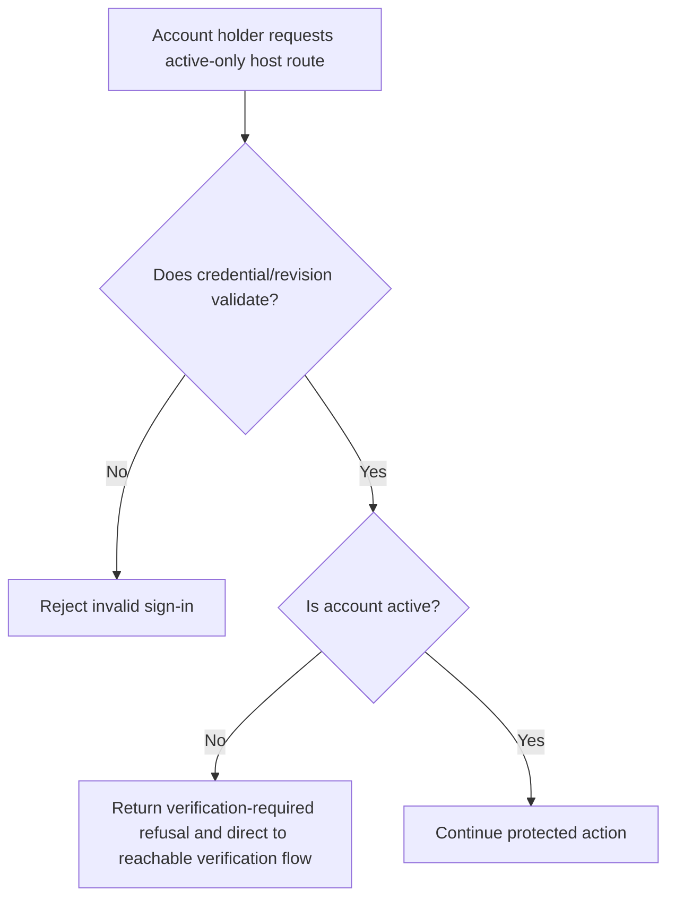
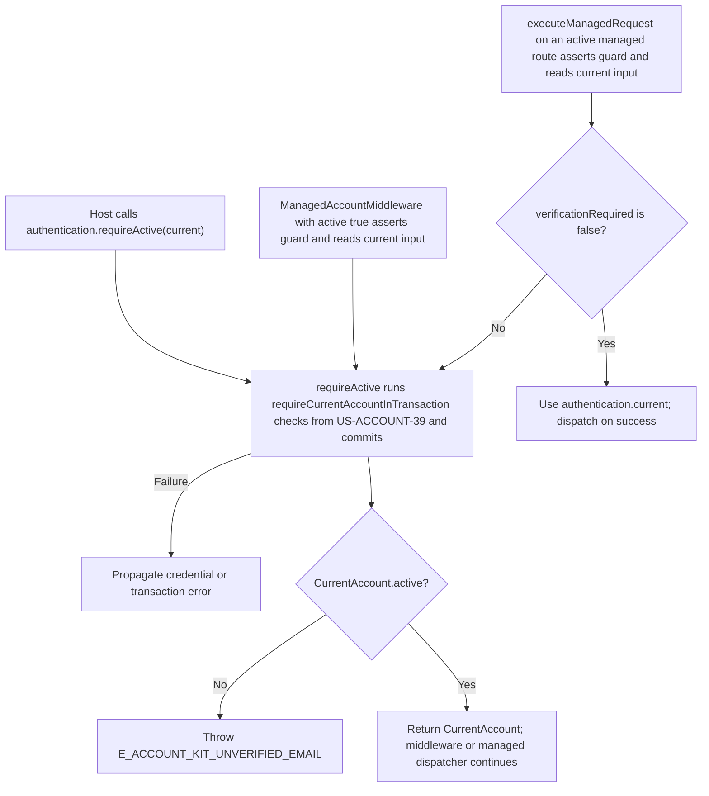

# US-ACCOUNT-40 — Require an active account

As an application developer, I want to require an active account before a protected action so that unconfirmed accounts cannot use active-only operations.

**Status:** Current when authentication is configured
**Access:** The host applies this check to routes that require an active account; it decides which routes remain available for verification and sign-out.
**Entry:** Host calls `authentication.requireActive(current)` or attaches `new ManagedAccountMiddleware({ kit, guard, active: true })`. Managed routes marked `active` enforce this check by default.
**Documentation:** [Authentication](../docs/guide/authentication.md)
**Source:** [`src/authentication.ts`](../src/authentication.ts)
**Coverage:** [`tests/authentication.spec.ts`](../tests/authentication.spec.ts), [`tests/managed_http_live_account.spec.ts`](../tests/managed_http_live_account.spec.ts)

## Acceptance criteria

- Input is the full `CurrentAccountInput`; success returns the safe current account when active. A valid account with its only address awaiting confirmation throws `E_ACCOUNT_KIT_UNVERIFIED_EMAIL` after the current-account transaction completes. A pending change to a different address keeps the account active.
- Managed routes marked `active` use the ordinary current-account check when `verificationRequired: false`. The host keeps verification and sign-out available to inactive accounts.

## User flow

## Code flow

Scope: entry and active check through handler dispatch. See [US-ACCOUNT-39](US-ACCOUNT-39-current-account.md) for shared account and sign-in checks.

**Code references:** [`requireActive`](../src/authentication.ts), [host middleware](../src/http/managed_account_middleware.ts), [managed dispatcher](../src/http/managed_execution.ts), [active projection](../src/account_projection.ts), [`authentication tests`](../tests/authentication.spec.ts)
