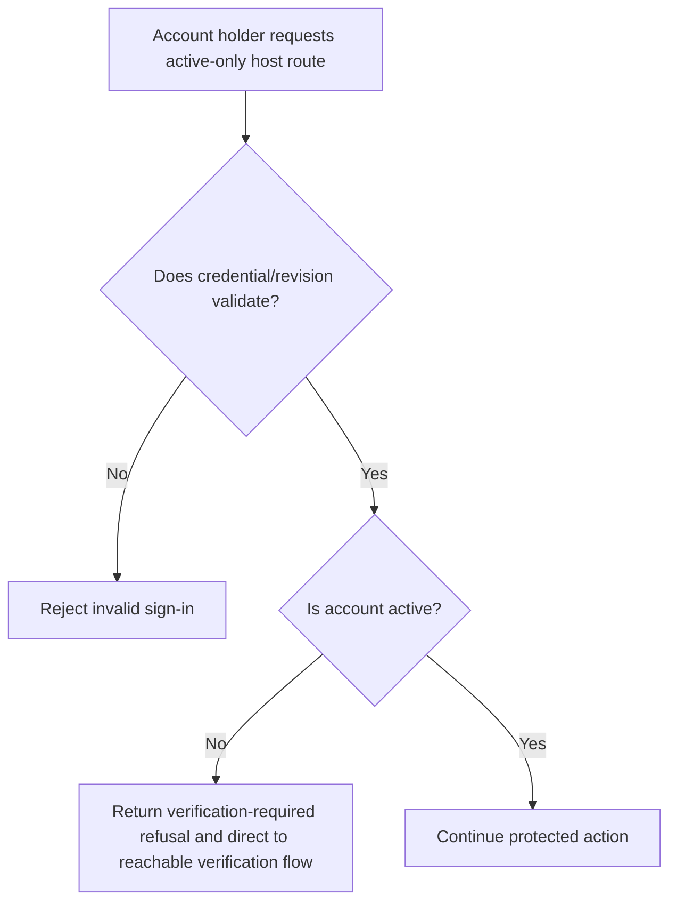
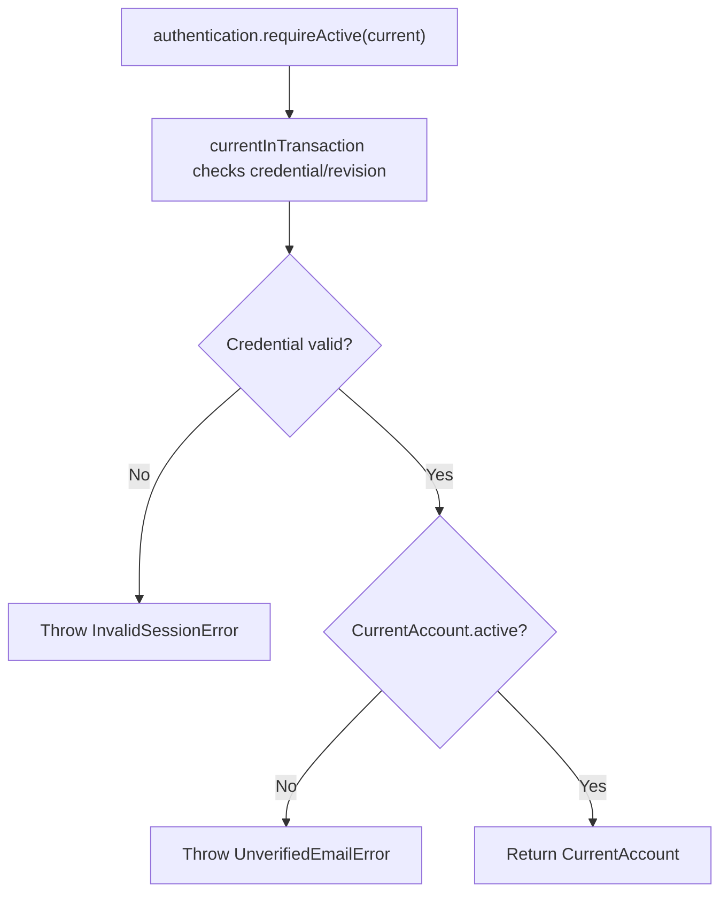

# US-ACCOUNT-40 — Require an active account

As an application developer, I want to require a verified account before a protected action so that unconfirmed accounts cannot use active-only operations.

**Status:** Current when authentication is configured
**Access:** The host applies this check to routes that require an active account; it decides which routes remain available for verification and sign-out.
**Entry:** Host calls `authentication.requireActive(current)` or uses a managed route configured as active.
**Documentation:** [Authentication](../docs/guide/authentication.md)
**Source:** [`src/authentication.ts`](../src/authentication.ts)
**Coverage:** [`tests/authentication.spec.ts`](../tests/authentication.spec.ts), [`tests/managed_http_live_account.spec.ts`](../tests/managed_http_live_account.spec.ts)

## Acceptance criteria

- Input is the full `CurrentAccountInput`; success returns the safe current account when active. A valid but unconfirmed account throws `UnverifiedEmailError`; a revoked credential fails current-account validation first.
- Host keeps verification and sign-out journeys reachable for inactive accounts.

## User flow

## Code flow

Scope: service check; the application chooses and attaches the active-account boundary.

**Code references:** [`requireActive`](../src/authentication.ts), [`managed account checks`](../src/http/managed_account_middleware.ts), [`authentication tests`](../tests/authentication.spec.ts)
