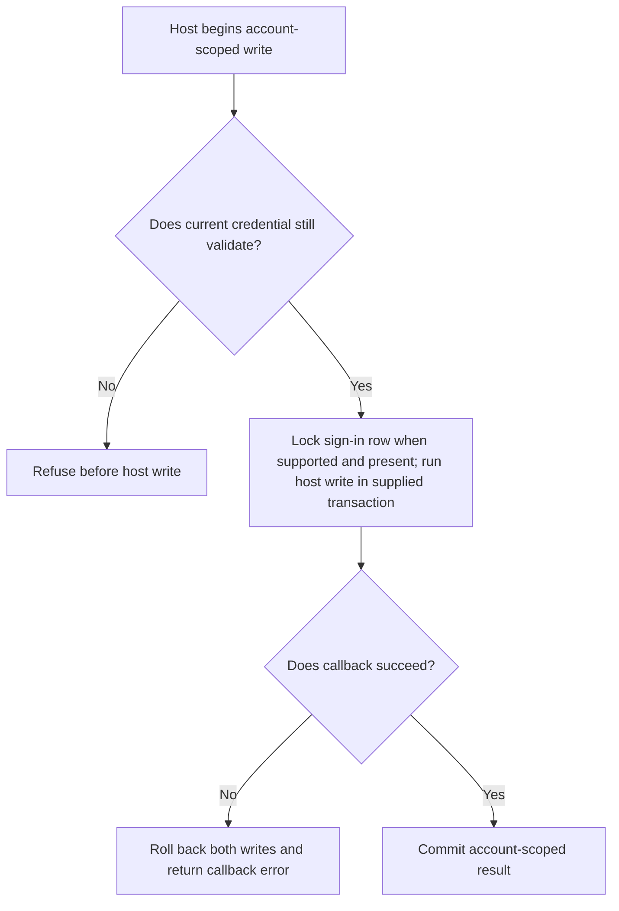
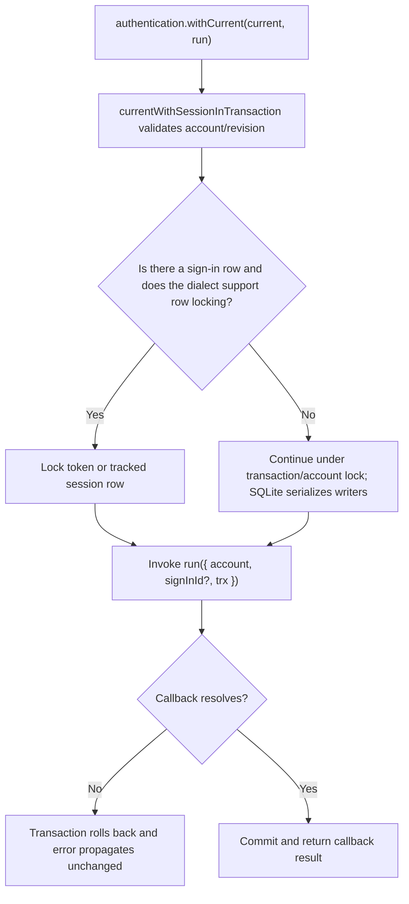

# US-ACCOUNT-41 — Commit a host write with a tracked current sign-in

As an application developer, I want a host-owned write to share Account Kit's current-credential transaction so that a tracked credential revocation cannot race that write.

**Status:** Current when authentication is configured
**Access:** Host authenticates and authorizes the account before passing its `CurrentAccountInput`; the callback must use the supplied transaction for every write.
**Entry:** Host calls `authentication.withCurrent(current, async ({ account, signInId, trx }) => ...)`.
**Documentation:** [Protected requests](../docs/guide/authentication.md#protected-requests)
**Source:** [`src/authentication.ts`](../src/authentication.ts)
**Coverage:** [`tests/session_management.spec.ts`](../tests/session_management.spec.ts), [`tests/authentication.spec.ts`](../tests/authentication.spec.ts)

## Acceptance criteria

- `withCurrent` returns the callback result. It checks the current account and credential, then runs the callback under the same transaction. For non-SQLite databases it locks the corresponding token row or tracked session row if that row exists; `signInId` is present only for a tracked session sign-in. SQLite serializes writers instead of locking a sign-in row. With session management disabled there is no registry row to lock.
- A callback error rolls back Kit and callback writes. Callback work must be database-only and retry-safe. Where a tracked sign-in row is locked, concurrent logout/token deletion waits for this transaction; do not assume a universal logout-wait guarantee for untracked sessions or every database.

## User flow

## Code flow

Scope: callback executes inside the Account Kit transaction and must use its `trx`.

**Code references:** [`withCurrent` and `lockSignIn`](../src/authentication.ts), [`protected requests guide`](../docs/guide/authentication.md#protected-requests)
