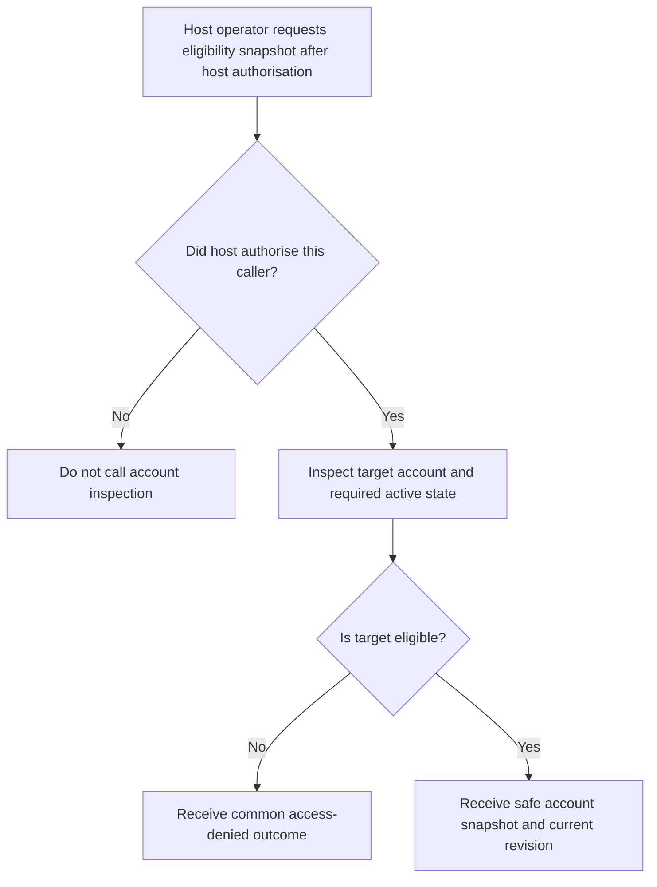
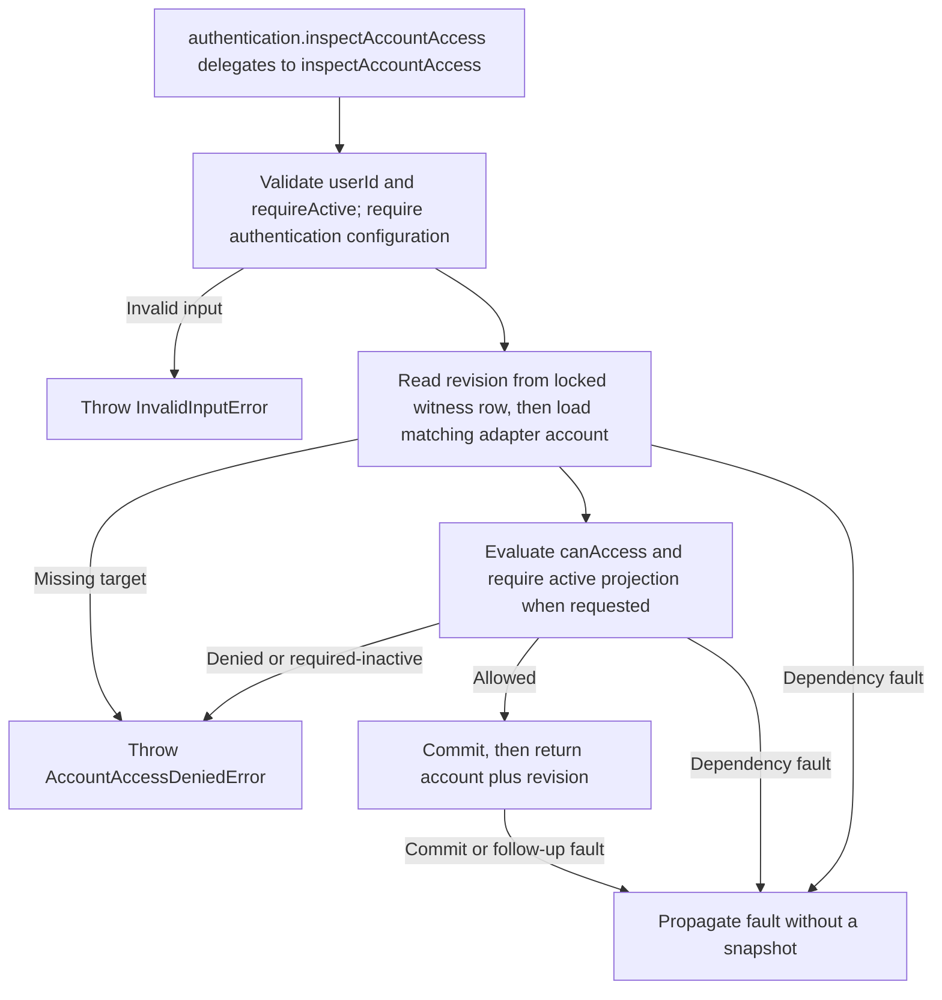

# US-ACCOUNT-42 — Inspect account access before acting

As an application operator, I want an authorised host workflow to inspect another account's eligibility and credential revision so that it can decide whether to offer access or support action.

**Status:** Current when authentication is configured
**Access:** `inspectAccountAccess` is not authentication; the host must authorise the caller before invoking it. Missing, restricted and optionally inactive accounts share the access-denied error.
**Entry:** Host authorises its caller, then calls `authentication.inspectAccountAccess({ userId, requireActive })`.
**Documentation:** [Inspecting another account](../docs/guide/authentication.md#inspecting-another-account)
**Source:** [`src/account_access_inspection.ts`](../src/account_access_inspection.ts)
**Coverage:** [`tests/account_access_inspection.spec.ts`](../tests/account_access_inspection.spec.ts)

## Acceptance criteria

- Input is the target `userId` and required `requireActive` boolean; success returns `{ account, revision }`, a point-in-time snapshot. It accepts no target credential and does not authorise the host caller.
- Missing, denied or required-inactive targets produce `AccountAccessDeniedError`. Malformed input produces `InvalidInputError`. Dependency and adapter errors remain faults. Treat the snapshot as point-in-time data. If a follow-up fails after commit, retry the read.

## User flow

## Code flow

Scope: the host authorises the caller, then Account Kit opens a separate transaction. Adapters and `canAccess` must make retry-safe, read-only calls through that transaction.

**Code references:** [`inspectAccountAccess`](../src/account_access_inspection.ts), [`authentication API`](../src/authentication.ts), [decision validation](../src/account_access_decision.ts), [`inspection tests`](../tests/account_access_inspection.spec.ts)
