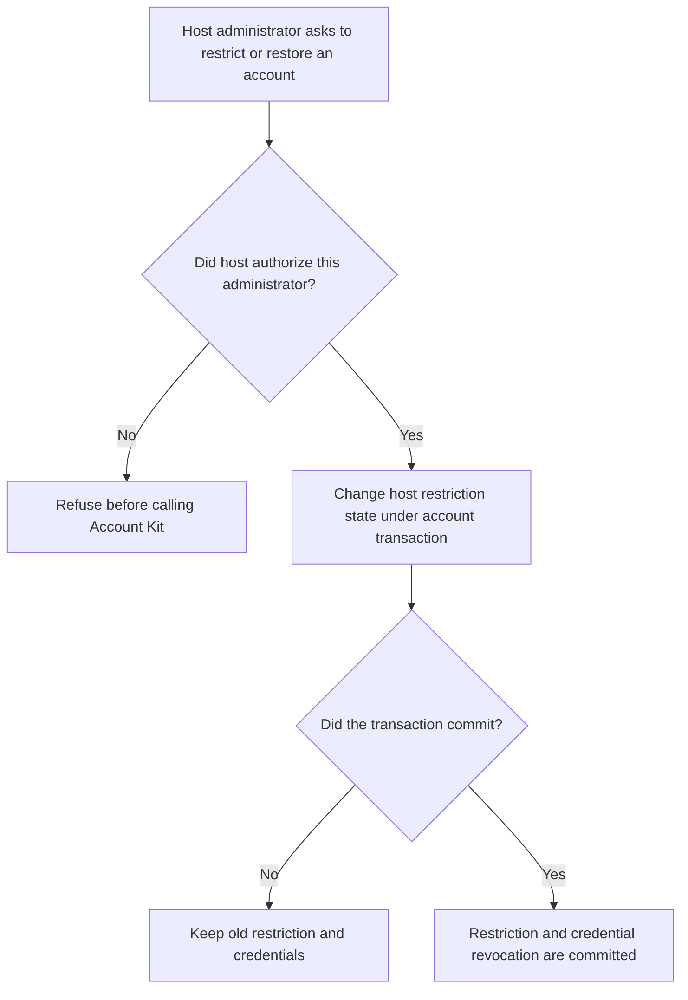
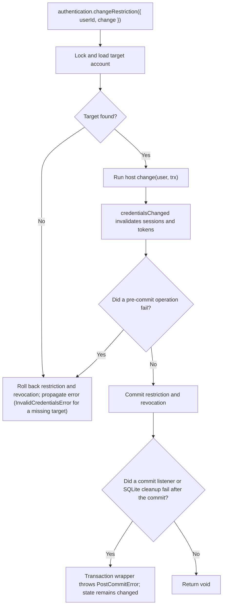

# US-ACCOUNT-43 — Change an account restriction

As an application administrator, I want to change an account's restriction state through my host policy so that restricted credentials stop working.

**Status:** Current when authentication is configured
**Access:** The host must authorize the administrator before calling this service; Account Kit supplies no universal administrator role.
**Entry:** Authorized host service calls `authentication.changeRestriction({ userId, change })` and uses the supplied transaction for its policy-state mutation.
**Documentation:** [Account security](../docs/guide/authentication.md)
**Source:** [`src/authentication.ts`](../src/authentication.ts)
**Coverage:** [`tests/authentication.spec.ts`](../tests/authentication.spec.ts)

## Acceptance criteria

- Input requires target `userId` and an async database-only `change(user, trx)` callback. The method returns `void`; callback mutation and credential revocation commit together.
- A missing target throws `InvalidCredentialsError`. If that, the callback or the transaction fails before commit, neither the restriction change nor credential revision/revocation commits. After commit, existing credentials are invalidated.
- No lifecycle post-commit hook, credential observer or notification runs for a restriction change. A failure after the commit still makes the transaction wrapper throw `PostCommitError`: a commit listener that `change(user, trx)` registered on `trx` can throw on any dialect, and on SQLite transaction cleanup can fail. The committed restriction and revocation stay in place.

## User flow

## Code flow

Scope: host policy callback and credential revocation share one locked transaction. No lifecycle post-commit hook or observer runs for this operation.

**Code references:** [`changeRestriction`](../src/authentication.ts), [`credential invalidation`](../src/credential_revision.ts), [`transaction wrapper`](../src/transaction.ts), [`authentication tests`](../tests/authentication.spec.ts)
