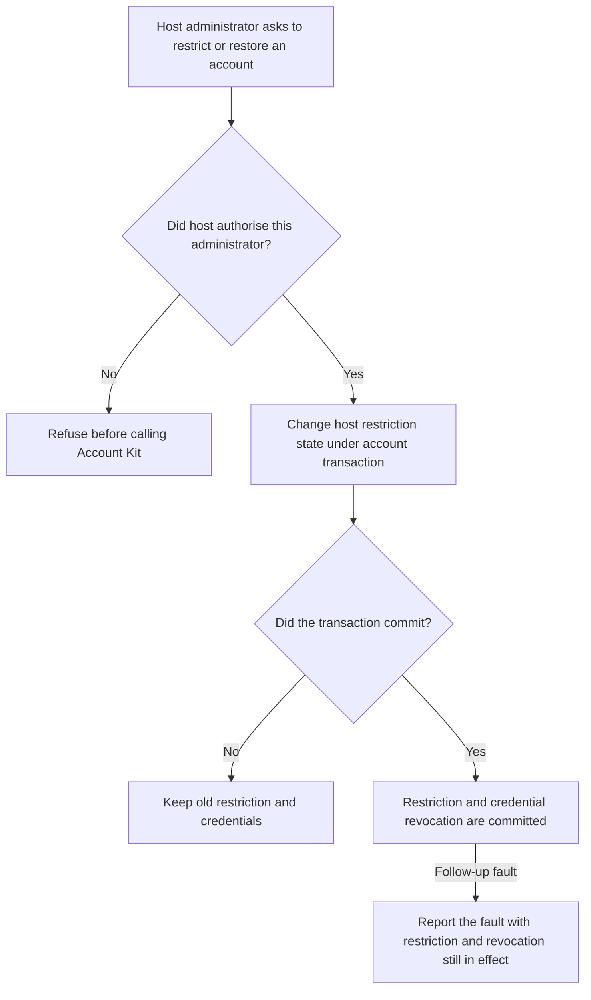
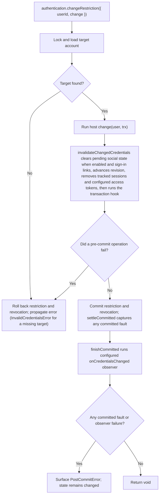

# US-ACCOUNT-43 — Change an account restriction

As an application administrator, I want to change an account's restriction state through my host policy so that restricted credentials stop working.

**Status:** Current when authentication is configured
**Access:** The host must authorise the administrator before calling this service; Account Kit supplies no universal administrator role.
**Entry:** Authorised host service calls `authentication.changeRestriction({ userId, change })` and uses the supplied transaction for its policy-state mutation.
**Documentation:** [Account security](../docs/guide/authentication.md)
**Source:** [`src/authentication.ts`](../src/authentication.ts)
**Coverage:** [`tests/authentication.spec.ts`](../tests/authentication.spec.ts), [`tests/authentication_credentials.spec.ts`](../tests/authentication_credentials.spec.ts)

## Acceptance criteria

- Input requires target `userId` and an async database-only `change(user, trx)` callback. The method returns `void`. Callback mutation and credential revocation share a transaction, including the optional `onCredentialsChangedTransaction(user, context, trx)` hook.
- A missing target throws `InvalidCredentialsError`. If that, the callback or the transaction fails before commit, neither the restriction change nor credential revision/revocation commits. After commit, existing credentials are invalidated.
- The configured `onCredentialsChanged` observer runs after the commit. No lifecycle event or notification is emitted by this operation. A commit listener, SQLite cleanup or observer failure may surface as `PostCommitError`; the committed restriction and revocation stay in place.

## User flow

## Code flow

Scope: host policy callback and credential revocation share one locked transaction. The configured credential observer runs after commit.

**Code references:** [`changeRestriction`](../src/authentication.ts), [`credential invalidation`](../src/credential_revision.ts), [transaction wrapper](../src/transaction.ts), [committed follow-ups](../src/effects.ts), [`authentication tests`](../tests/authentication.spec.ts)
