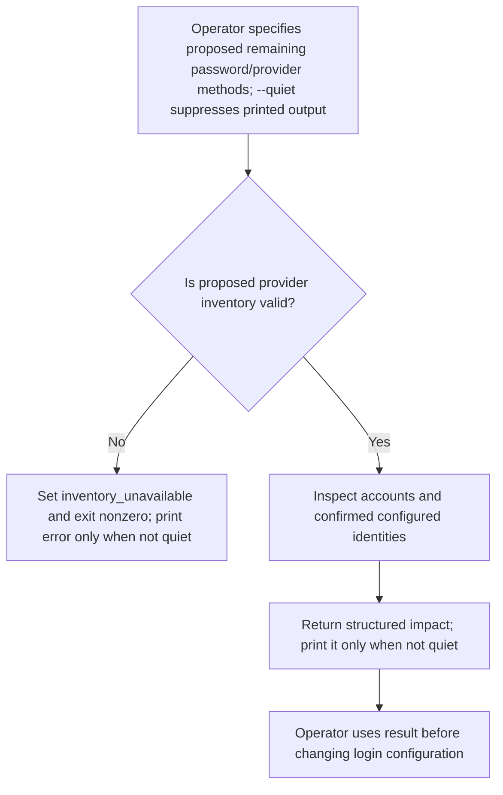
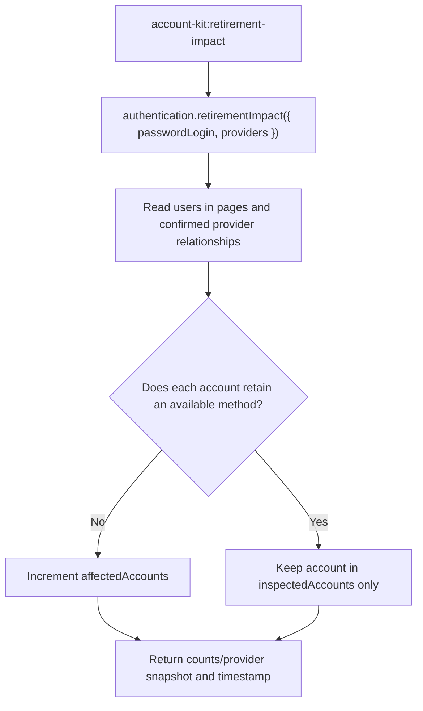

# US-ACCOUNT-44 — Check login-method retirement impact

As an application operator, I want to count accounts affected by a proposed login-method change so that I can avoid removing every usable sign-in path.

**Status:** Operator
**Access:** Requires a booted, configured application and database access; the command is read-only.
**Entry:** Run `account-kit:retirement-impact [--keep-password-login] [--providers <list>] [--quiet]`.
**Documentation:** [Identity creation](../docs/guide/identity-creation.md)
**Source:** [`commands/retirement_impact.ts`](../commands/retirement_impact.ts)
**Coverage:** [`tests/authentication_retirement.spec.ts`](../tests/authentication_retirement.spec.ts), [`tests/social_retirement.spec.ts`](../tests/social_retirement.spec.ts)

## Acceptance criteria

- The command reports inspected/affected account counts, checkedAt, current providers and current password-login state. `--providers` names unique supported providers remaining; omitted means currently configured providers, `none` means none. `--keep-password-login` opts into retaining password login; otherwise password login is considered removed. `--quiet` suppresses success and error text while preserving the structured `impact` or `failure` result and nonzero exit status on error.
- Invalid configuration or unavailable inventory exits nonzero with a generic inventory-unavailable result; the command changes no account or provider state.

## User flow

## Code flow

Scope: paginated read-only account inventory; no retirement is performed.

**Code references:** [`retirement-impact command`](../commands/retirement_impact.ts), [`authentication.retirementImpact`](../src/authentication.ts), [`retirement inventory`](../src/login_method_retirement.ts)
