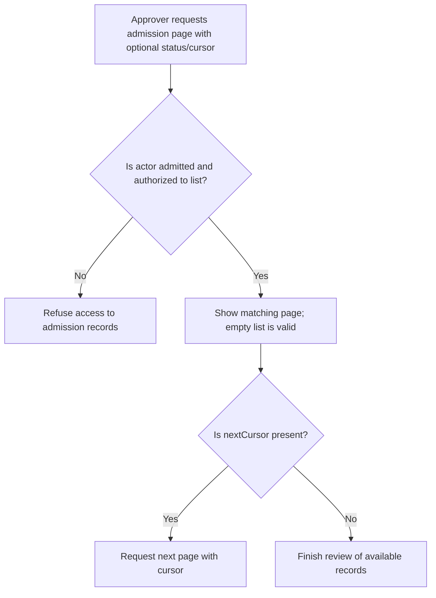
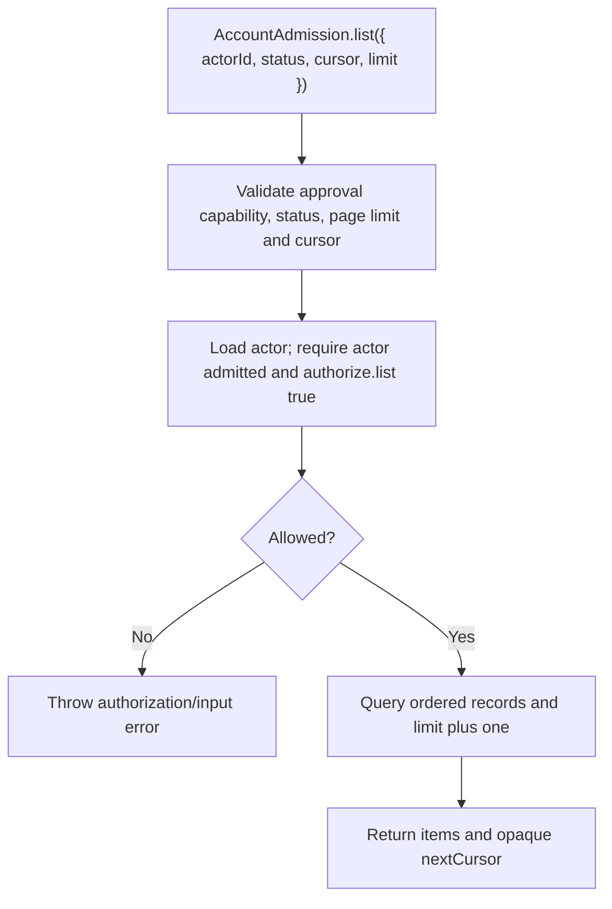

# US-ACCOUNT-45 — List admission records

As an authorized application approver, I want to review a page of admission records so that I can find pending requests and current decisions.

**Status:** Current when the admission approval requirement is enabled
**Access:** Actor must be admitted and `approval.authorize.list(actor)` must return exactly true.
**Entry:** Host-owned route calls `AccountAdmission.list({ actorId, status?, cursor?, limit? })`; no admission managed route is supplied.
**Documentation:** [Admission](../docs/guide/admission.md)
**Source:** [`src/admission/listing.ts`](../src/admission/listing.ts)
**Coverage:** [`tests/admission_listing.spec.ts`](../tests/admission_listing.spec.ts)

## Acceptance criteria

- `actorId` is required; status is optionally `pending`, `approved`, `rejected` or `revoked`; limit defaults to 25 and must be 1–100; cursor is the opaque nextCursor from a prior page. Result is `{ items, nextCursor }`.
- `pending` selects accounts that requested and have no approval decision; omitted status lists all records. Unauthorized/non-admitted actors are refused; no matching rows returns an empty page.

## User flow

## Code flow

Scope: approval capability, actor eligibility, callback authorization and bounded page query.

**Code references:** [`AccountAdmission.list`](../src/admission/service.ts), [`listAdmissions`](../src/admission/listing.ts), [`listing tests`](../tests/admission_listing.spec.ts)
