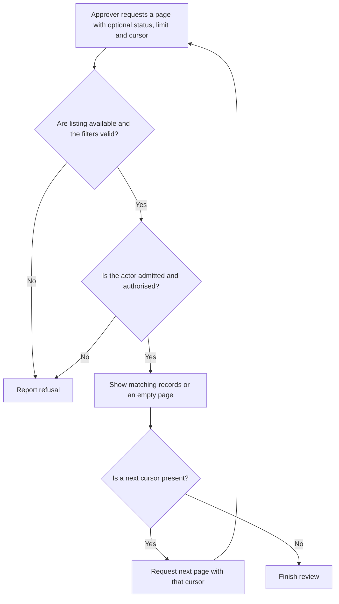
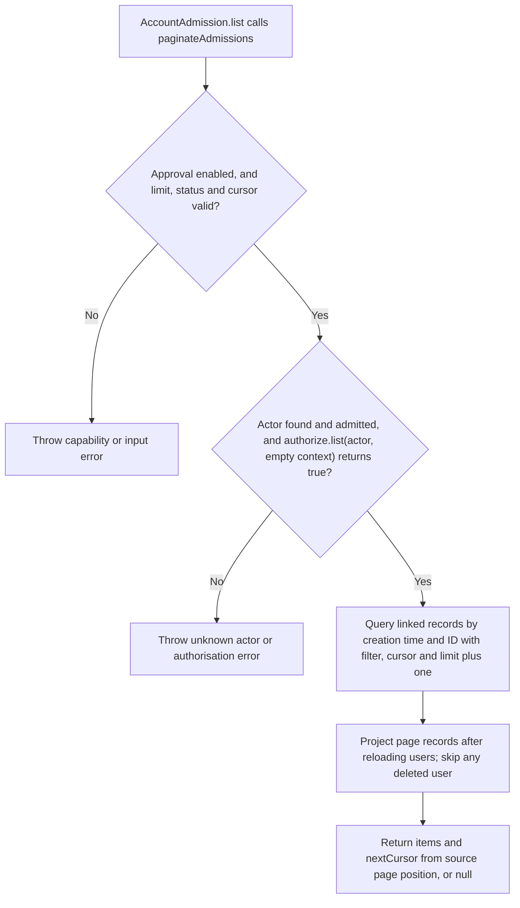

# US-ACCOUNT-45 — List admission records

As an authorised application approver, I want to review a page of admission records so that I can find pending requests and current decisions.

**Status:** Current when the admission approval requirement is enabled
**Access:** Actor must be admitted and `approval.authorize.list(actor, {})` must return exactly true.
**Entry:** Host-owned route calls `AccountAdmission.list({ actorId, status?, cursor?, limit? })`; no admission managed route is supplied.
**Documentation:** [Admission](../docs/guide/admission.md)
**Source:** [`src/admission/listing.ts`](../src/admission/listing.ts)
**Coverage:** [`tests/admission_listing.spec.ts`](../tests/admission_listing.spec.ts)

## Acceptance criteria

- `actorId` is required. Optional `status` is `pending`, `approved`, `rejected` or `revoked`; `limit` defaults to 25 and must be an integer from 1 to 100. Pass the opaque `nextCursor` from a prior page as `cursor`. Missing approval capability or invalid inputs are refused before loading the actor.
- The actor must be admitted and `approval.authorize.list(actor, {})` must return exactly `true`. This callback receives an empty context without a transaction.
- `{ items, nextCursor }` contains records linked to accounts, oldest first with an ID tiebreak. Omitted status includes all linked states; `pending` requires a request and no decision. Waiting bootstrap approvals are excluded. If an account is deleted between reads, its record is skipped and pagination still follows the source page.

## User flow

## Code flow

Scope: approval capability, actor eligibility, callback authorisation and bounded page query.

The runnable API example traces the controller and middleware entry in its [admission code flow](../examples/api/README.md#admission-code-flow).

**Code references:** [`AccountAdmission.list`](../src/admission/service.ts), [`paginateAdmissions`](../src/admission/listing.ts), [`listing tests`](../tests/admission_listing.spec.ts)
