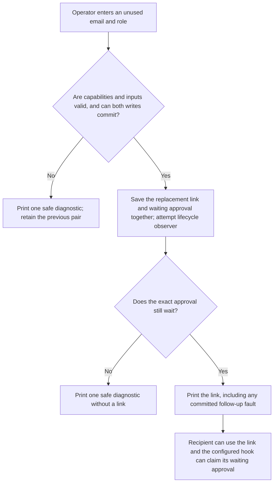
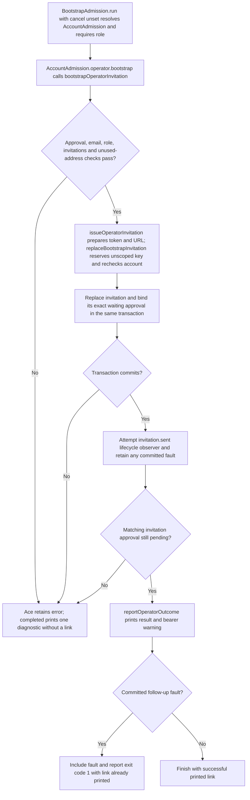

# US-ACCOUNT-46 — Bootstrap an approved administrator invitation

As an application operator, I want to invite an administrator and prepare its approval together so that the first account can be approved without an existing approver.

**Status:** Operator
**Access:** Shell access and explicitly enabled `invitations` and admission approval capabilities; host must configure `withInvitationEvidence` from [US-ACCOUNT-51](US-ACCOUNT-51-configure-admission-hooks.md) for acceptance to attach invitation evidence and claim the waiting approval. Command issues a printed bearer link.
**Entry:** Run `account-kit:admission:bootstrap <email> --role <role>`; the role is required and accepts 1–64 characters as supplied, including whitespace.
**Documentation:** [Admission bootstrap](../docs/guide/admission.md#first-administrator)
**Source:** [`src/admission/bootstrap.ts`](../src/admission/bootstrap.ts)
**Coverage:** [`tests/admission_bootstrap_command.spec.ts`](../tests/admission_bootstrap_command.spec.ts), [`tests/admission_bootstrap.spec.ts`](../tests/admission_bootstrap.spec.ts)

## Acceptance criteria

- The command requires a valid unused email and role of 1–64 characters. It checks for an existing account before URL preparation and again after reserving the invitation key. A successful transaction replaces the same-address unscoped link and its waiting approval together, leaving other invitation scopes intact. A transaction failure preserves the previous pair.
- After commit it attempts the operator `invitation.sent` lifecycle observer, then checks that the exact approval is still waiting. If replacement or cancellation removes that approval, the command reports a failure without exposing a link. If the approval still waits, stdout returns `result: 'printed'`, invitation ID, email, role, expiry, approval and URL. A committed follow-up fault also appears in the result and exits with code 1.
- The waiting approval is bound to this invitation ID. [US-ACCOUNT-51](US-ACCOUNT-51-configure-admission-hooks.md) describes how the configured acceptance wrapper claims it. Other enabled admission requirements still apply and role assignment stays with the host.
- A thrown runtime error stays on Ace's `command.error`, exits nonzero and produces one safe diagnostic on stderr.

## User flow

## Code flow

Scope: admission operator service binds the approval inside the shell-trusted invitation transaction, serialised by the unique invitation address and scope.

**Code references:** [`bootstrapOperatorInvitation`](../src/admission/bootstrap.ts), [`bootstrap command`](../src/admission/commands/bootstrap.ts), [`operator invitation`](../src/operator.ts), [`bootstrap invitation persistence`](../src/bootstrap_invitation.ts), [command output](../commands/operator_output.ts), [invitation evidence handoff](US-ACCOUNT-51-configure-admission-hooks.md#code-flow), [operator service entry](../src/admission/service.ts)
