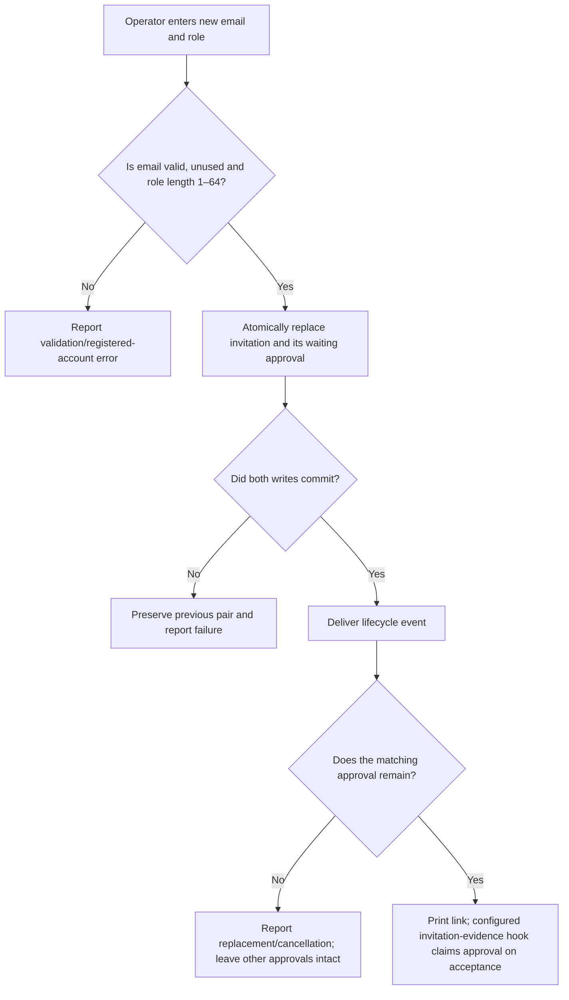
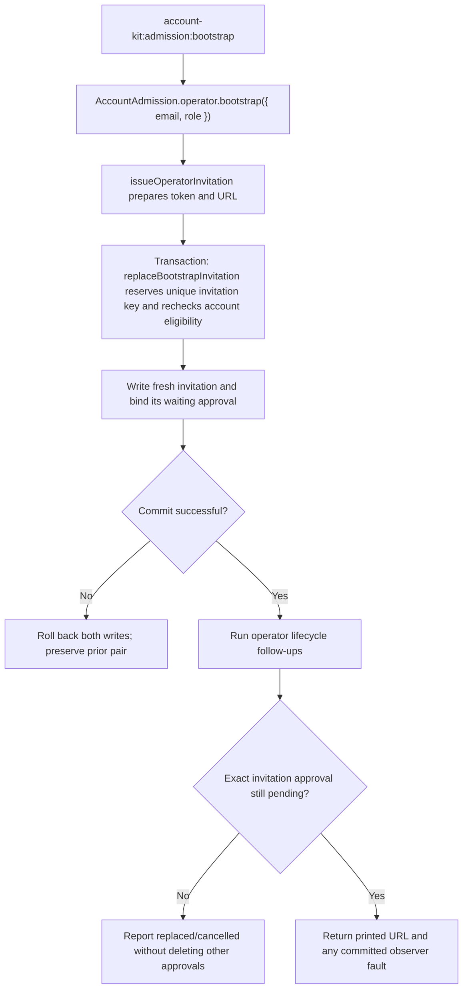

# US-ACCOUNT-46 — Bootstrap an approved administrator invitation

As an application operator, I want to invite an administrator and prepare its approval together so that the first account can be approved without an existing approver.

**Status:** Operator
**Access:** Shell access and explicitly enabled `invitations` and admission approval capabilities; host must configure `withInvitationEvidence` from [US-ACCOUNT-51](US-ACCOUNT-51-configure-admission-hooks.md) for acceptance to attach invitation evidence and claim the waiting approval. Command issues a printed bearer link.
**Entry:** Run `account-kit:admission:bootstrap <email> --role <role>`; the role is required and 1–64 characters.
**Documentation:** [Admission bootstrap](../docs/guide/admission.md#first-administrator)
**Source:** [`src/admission/bootstrap.ts`](../src/admission/bootstrap.ts)
**Coverage:** [`tests/admission_bootstrap_command.spec.ts`](../tests/admission_bootstrap_command.spec.ts), [`tests/admission_bootstrap.spec.ts`](../tests/admission_bootstrap.spec.ts)

## Acceptance criteria

- Input is email and role; command atomically replaces the invitation and its waiting approval, then prints the invitation URL in structured command output after commit and lifecycle delivery. It refuses malformed email, invalid role or an existing account, including an account found after acquiring the invitation reservation.
- Acceptance attaches invitation evidence and claims the waiting approval only when the host configures `withInvitationEvidence` from [US-ACCOUNT-51](US-ACCOUNT-51-configure-admission-hooks.md). A failed write rolls back both changes and preserves the previous invitation and approval. A replacement or cancellation during lifecycle delivery reports failure without deleting another operation’s approval; the invitation’s claimed approval is not transferred to a different link.

## User flow

## Code flow

Scope: admission operator service binds the approval inside the shell-trusted invitation transaction, serialised by the unique invitation address and scope.

**Code references:** [`operatorBootstrap`](../src/admission/bootstrap.ts), [`bootstrap command`](../src/admission/commands/bootstrap.ts), [`operator invitation`](../src/operator.ts), [`bootstrap invitation persistence`](../src/bootstrap_invitation.ts)
