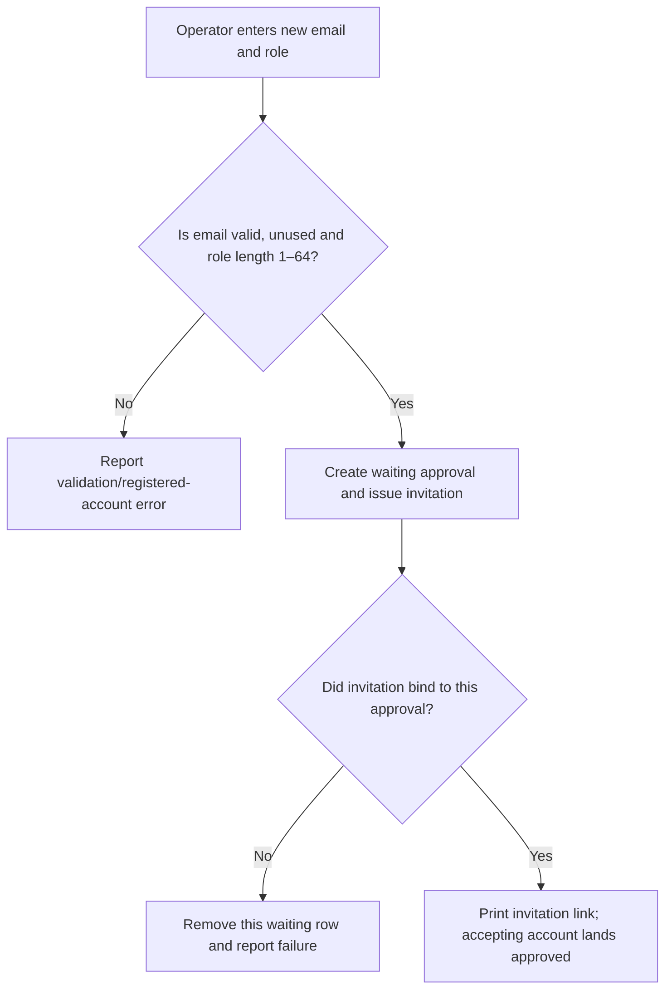
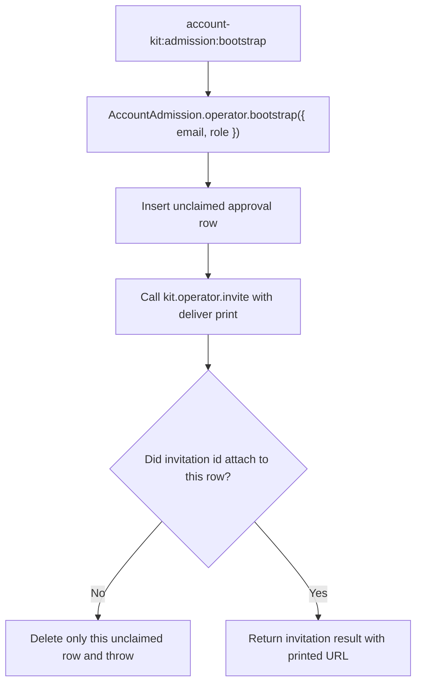

# US-ACCOUNT-46 — Bootstrap an approved administrator invitation

As an application operator, I want to invite an administrator and prepare its approval together so that the first account can be approved without an existing approver.

**Status:** Operator
**Access:** Shell access and enabled invitation plus admission approval capabilities; command issues a printed bearer link.
**Entry:** Run `account-kit:admission:bootstrap <email> --role <role>`; the role is required and 1–64 characters.
**Documentation:** [Admission bootstrap](../docs/guide/admission.md#first-administrator)
**Source:** [`src/admission/bootstrap.ts`](../src/admission/bootstrap.ts)
**Coverage:** [`tests/admission_bootstrap_command.spec.ts`](../tests/admission_bootstrap_command.spec.ts)

## Acceptance criteria

- Input is email and role; command creates a waiting approval tied to the exact invitation and prints the invitation URL in structured command output. It refuses malformed email, invalid role or an existing account.
- If invitation issuance fails or the waiting approval was replaced, this operation removes only its own waiting row and reports failure; the invitation’s claimed approval is not transferred to a different link.

## User flow

## Code flow

Scope: admission operator service composes an approval row with the shell-trusted invitation service.

**Code references:** [`operatorBootstrap`](../src/admission/bootstrap.ts), [`bootstrap command`](../src/admission/commands/bootstrap.ts), [`operator invitation`](../src/operator.ts)
