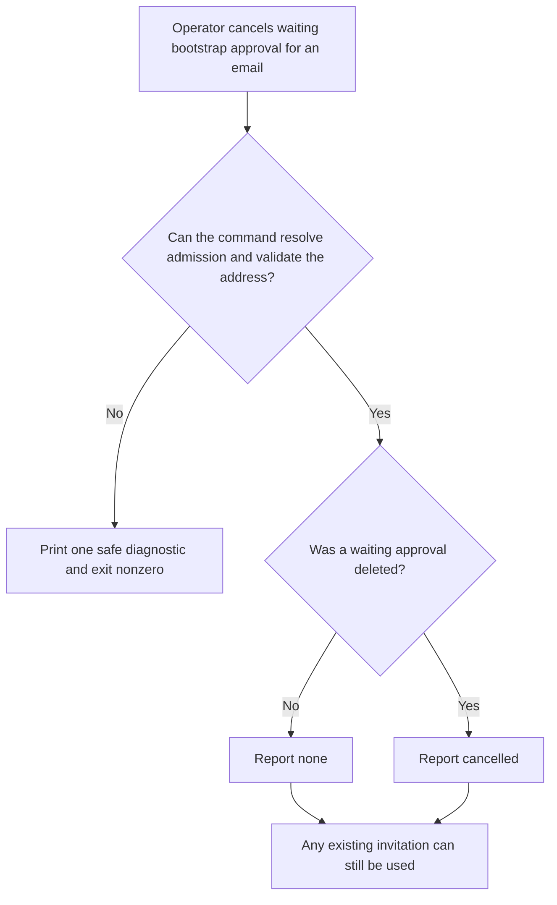
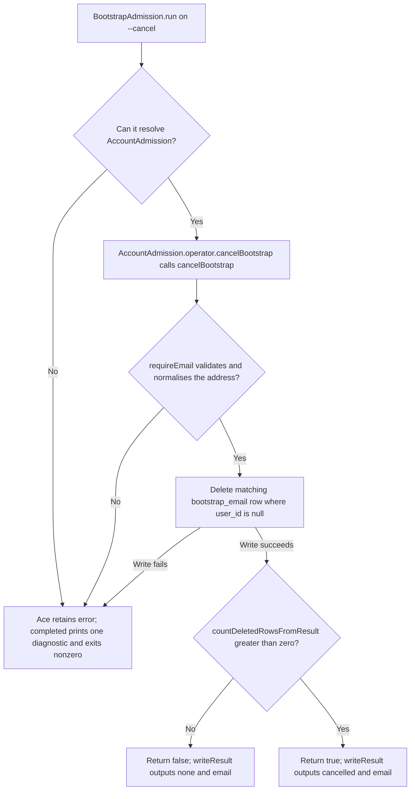

# US-ACCOUNT-47 — Cancel a waiting administrator bootstrap

As an application operator, I want to cancel a waiting bootstrap approval so that an unclaimed invitation can no longer create an approved account.

**Status:** Operator
**Access:** Shell access; the command deletes only an approval row for the address with no linked user.
**Entry:** Run `account-kit:admission:bootstrap <email> --cancel`.
**Documentation:** [Admission bootstrap](../docs/guide/admission.md#first-administrator)
**Source:** [`src/admission/bootstrap.ts`](../src/admission/bootstrap.ts)
**Coverage:** [`tests/admission_bootstrap_command.spec.ts`](../tests/admission_bootstrap_command.spec.ts)

## Acceptance criteria

- Supply a valid email and `--cancel`. This branch runs before the role check and needs no role or enabled approval requirement. Admission service resolution and the table are required.
- Output is `{ result: 'cancelled' | 'none', email }`. The command deletes a matching waiting row only when it has no linked user. The unchanged invitation may still be accepted and trigger the host's invitation callback. To remove both effects, revoke that link separately through the [invitation workflow](US-ACCOUNT-12-revoke-invitation.md).
- A thrown cancellation error stays on Ace's `command.error`, exits nonzero and produces one safe diagnostic on stderr.

## User flow

## Code flow

Scope: operator helper deletes by normalised bootstrap email only when user_id is null.

**Code references:** [`cancelBootstrap`](../src/admission/bootstrap.ts), [`bootstrap command`](../src/admission/commands/bootstrap.ts), [command output](../commands/operator_output.ts), [operator service entry](../src/admission/service.ts)
