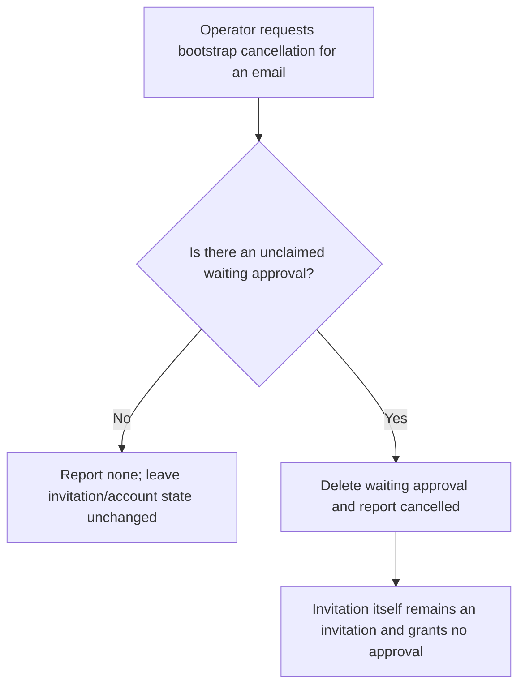
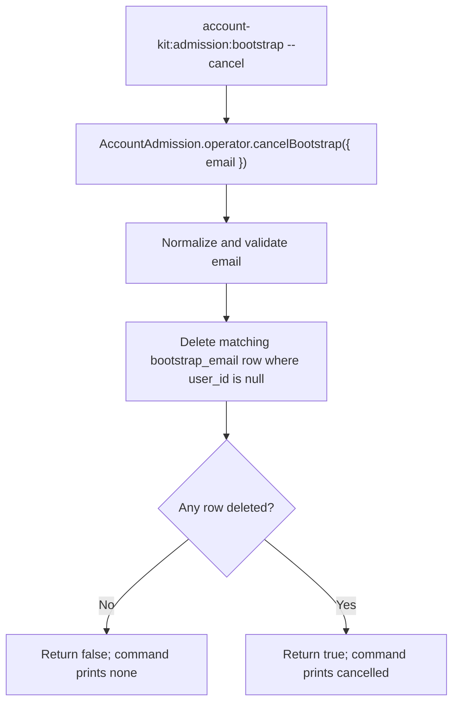

# US-ACCOUNT-47 — Cancel a waiting administrator bootstrap

As an application operator, I want to cancel a waiting bootstrap approval so that an unclaimed invitation can no longer create an approved account.

**Status:** Operator
**Access:** Shell access; the command deletes only an approval row for the address with no linked user.
**Entry:** Run `account-kit:admission:bootstrap <email> --cancel`.
**Documentation:** [Admission bootstrap](../docs/guide/admission.md#first-administrator)
**Source:** [`src/admission/bootstrap.ts`](../src/admission/bootstrap.ts)
**Coverage:** [`tests/admission_bootstrap_command.spec.ts`](../tests/admission_bootstrap_command.spec.ts)

## Acceptance criteria

- Command input is email and `--cancel`; output reports `cancelled` when a waiting row existed or `none` when there was nothing to cancel. A row already claimed by a user is not deleted.
- Cancellation prevents a still-unclaimed invitation from being paired with the removed approval; it does not delete an invitation or account.

## User flow

## Code flow

Scope: operator helper deletes by normalized bootstrap email only when user_id is null.

**Code references:** [`cancelBootstrap`](../src/admission/bootstrap.ts), [`bootstrap command`](../src/admission/commands/bootstrap.ts)
