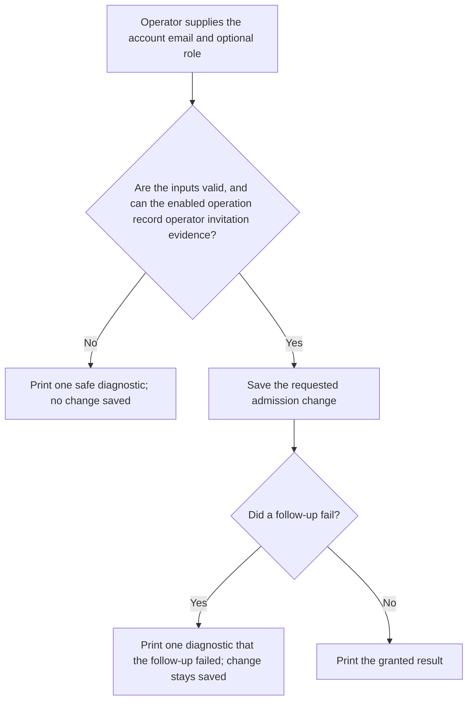
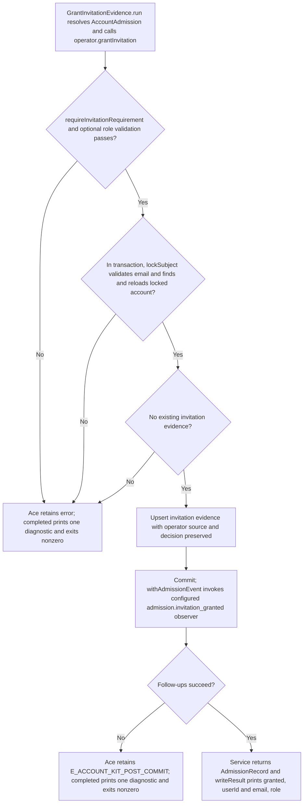

# US-ACCOUNT-48 — Grant invitation evidence to an existing account

As an application operator, I want to record invitation evidence for an existing account so that it can satisfy an enabled admission invitation requirement.

**Status:** Operator
**Access:** Shell access and enabled admission invitation requirement; stored role is evidence only and grants no application role.
**Entry:** Run `account-kit:admission:grant-invitation <email> [--role <role>]`.
**Documentation:** [Admission evidence](../docs/guide/admission.md#commands)
**Source:** [`src/admission/operator.ts`](../src/admission/operator.ts)
**Coverage:** [`tests/admission_operator.spec.ts`](../tests/admission_operator.spec.ts)

## Acceptance criteria

- The email identifies an existing account. Role is optional and accepts 1–64 characters; when omitted it is stored as null. The invitation requirement must be enabled. Existing evidence causes refusal. The record preserves any approval decision and stores evidence with `source: 'operator'` and a null invitation ID. The role records history and confers no host permission.
- On success the service returns the admission record and the command prints `result: 'granted'`, `userId` and `email` and role (or null). The configured observer receives `admission.invitation_granted` with operator source after commit. The command reports a committed observer failure on stderr with exit code 1 and the write saved.
- A thrown runtime error, including an `E_ACCOUNT_KIT_POST_COMMIT`, stays on Ace's `command.error` and produces one safe diagnostic on stderr with exit code 1.

## User flow

## Code flow

Scope: operator service transaction; the role field is historical evidence only.

**Code references:** [`grantOperatorInvitation`](../src/admission/operator.ts), [`grant command`](../src/admission/commands/grant_invitation.ts), [`operator tests`](../tests/admission_operator.spec.ts), [committed events](../src/admission/events.ts), [command output](../commands/operator_output.ts), [operator service entry](../src/admission/service.ts)
