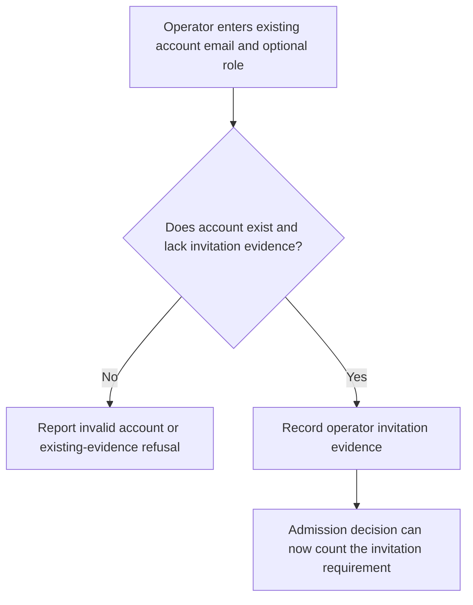
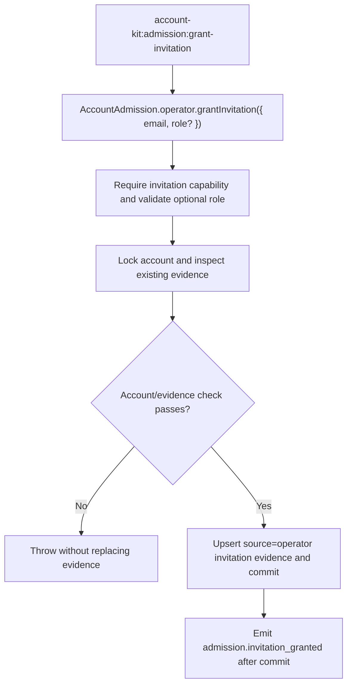

# US-ACCOUNT-48 — Grant invitation evidence to an existing account

As an application operator, I want to record invitation evidence for an existing account so that it can satisfy an enabled admission invitation requirement.

**Status:** Operator
**Access:** Shell access and enabled admission invitation requirement; stored role is evidence only and grants no application role.
**Entry:** Run `account-kit:admission:grant-invitation <email> [--role <role>]`.
**Documentation:** [Admission evidence](../docs/guide/admission.md#commands)
**Source:** [`src/admission/operator.ts`](../src/admission/operator.ts)
**Coverage:** [`tests/admission_operator.spec.ts`](../tests/admission_operator.spec.ts)

## Acceptance criteria

- Email is required; role is optional and, when present, must be 1–64 characters. The service returns the account’s admission record and emits an operator-sourced event after commit.
- Unknown account or existing invitation evidence is refused without replacing evidence. Role is recorded only; it grants no host permission.

## User flow

## Code flow

Scope: operator service transaction; the role field is historical evidence only.

**Code references:** [`operatorGrantInvitation`](../src/admission/operator.ts), [`grant command`](../src/admission/commands/grant_invitation.ts), [`operator tests`](../tests/admission_operator.spec.ts)
