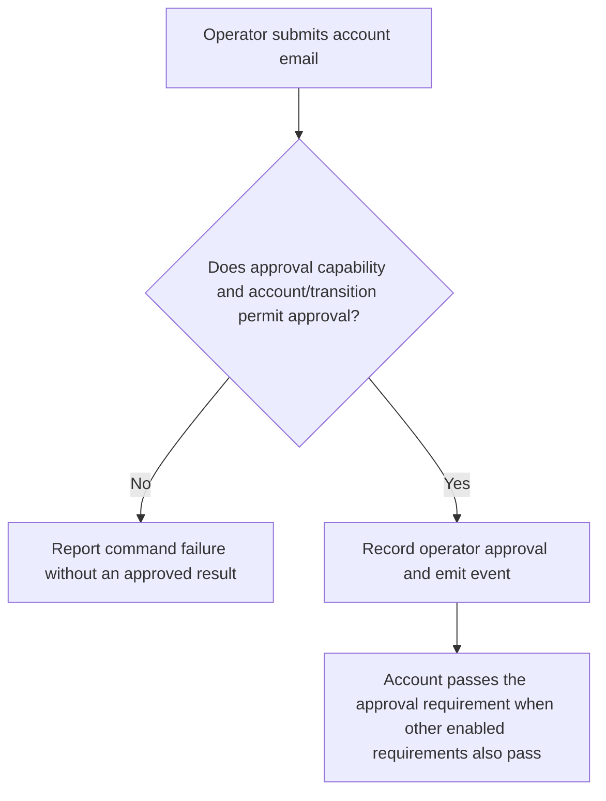
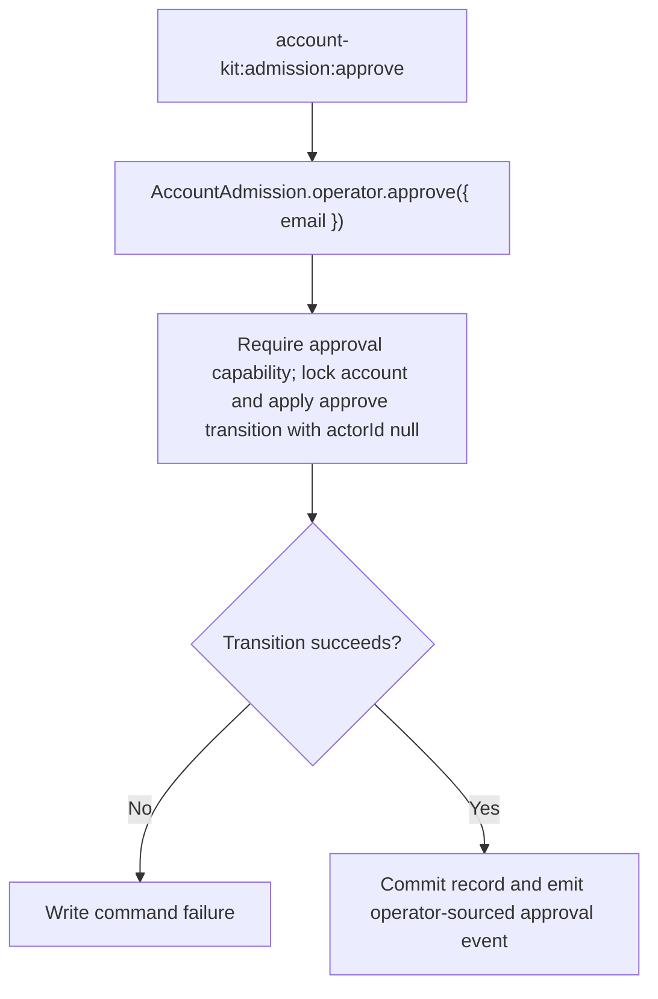

# US-ACCOUNT-49 — Approve an account as an operator

As an application operator, I want to approve an account from the trusted shell so that I can bootstrap or recover admission when no authorized approver is available.

**Status:** Operator
**Access:** Shell access and enabled approval requirement; command bypasses actor authorization callbacks.
**Entry:** Run `account-kit:admission:approve <email>`.
**Documentation:** [Admission operator commands](../docs/guide/admission.md#commands)
**Source:** [`src/admission/operator.ts`](../src/admission/operator.ts)
**Coverage:** [`tests/admission_commands.spec.ts`](../tests/admission_commands.spec.ts)

## Acceptance criteria

- Email identifies an existing account; success writes an approved decision with null actorId and operator source, returns the admission record and emits an event after commit.
- Missing account, disabled approval or invalid transition is reported as command failure; no application actor callback is treated as the shell authority.

## User flow

## Code flow

Scope: operator service has no actor and does not invoke `approval.authorize`.

**Code references:** [`operatorDecision`](../src/admission/operator.ts), [`approve command`](../src/admission/commands/approve.ts), [`command tests`](../tests/admission_commands.spec.ts)
