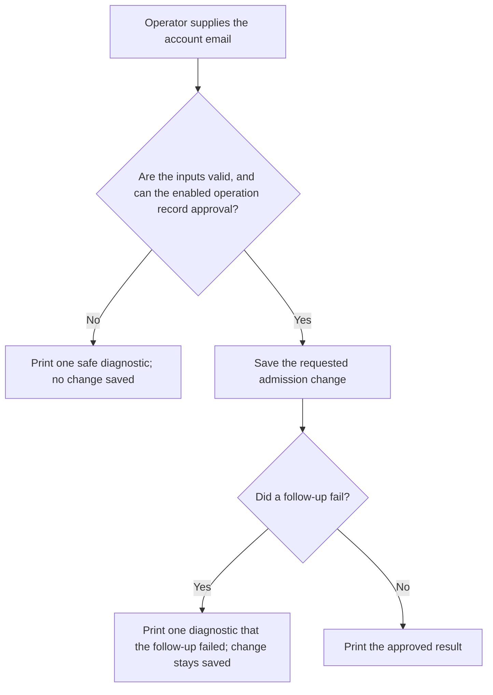
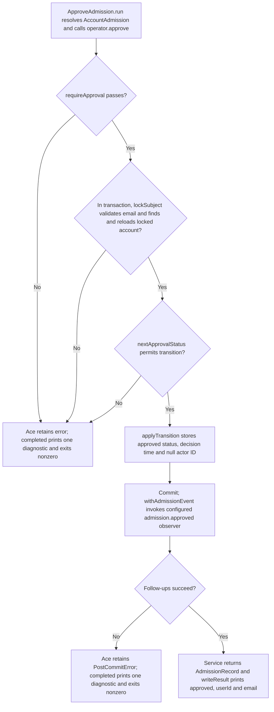

# US-ACCOUNT-49 — Approve an account as an operator

As an application operator, I want to approve an account from the trusted shell so that I can bootstrap or recover admission when no authorised approver is available.

**Status:** Operator
**Access:** Shell access and enabled approval requirement; command bypasses actor authorisation callbacks.
**Entry:** Run `account-kit:admission:approve <email>`.
**Documentation:** [Admission operator commands](../docs/guide/admission.md#commands)
**Source:** [`src/admission/operator.ts`](../src/admission/operator.ts)
**Coverage:** [`tests/admission_commands.spec.ts`](../tests/admission_commands.spec.ts)

## Acceptance criteria

- The email identifies an existing account. Approval must be enabled. Approval transitions from no decision, `rejected` or `revoked`; a repeat is refused. The decision stores a null actor ID and the decision time. Other enabled requirements still apply.
- On success the service returns the admission record and the command prints `result: 'approved'`, `userId` and `email`. The configured observer receives `admission.approved` with operator source after commit. The command reports a committed observer failure on stderr with exit code 1 and the write saved.
- A thrown runtime error, including a `PostCommitError`, stays on Ace's `command.error` and produces one safe diagnostic on stderr with exit code 1.

## User flow

## Code flow

Scope: operator service has no actor and does not invoke `approval.authorize`.

**Code references:** [`operatorDecision`](../src/admission/operator.ts), [`approve command`](../src/admission/commands/approve.ts), [`command tests`](../tests/admission_commands.spec.ts), [committed events](../src/admission/events.ts), [command output](../commands/operator_output.ts), [operator service entry](../src/admission/service.ts)
