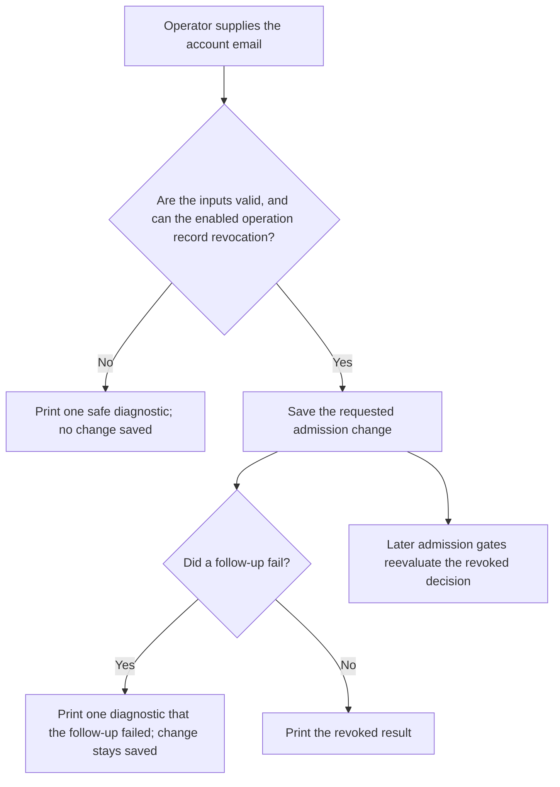
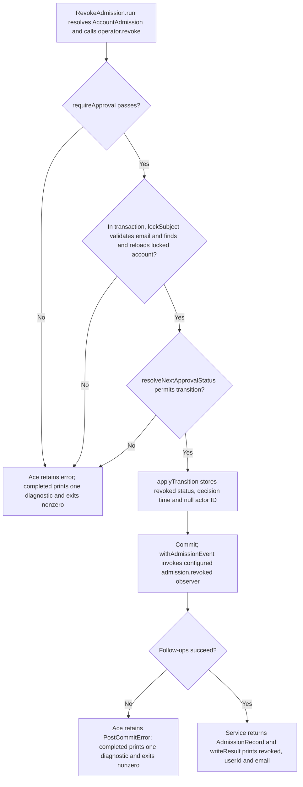

# US-ACCOUNT-50 — Revoke admission as an operator

As an application operator, I want to revoke an approved account from the trusted shell so that it no longer passes the admission gate.

**Status:** Operator
**Access:** Shell access and enabled approval requirement; the operation leaves credentials alone. Approval gates reject the account while the approval requirement is enabled and the decision remains revoked.
**Entry:** Run `account-kit:admission:revoke <email>`.
**Documentation:** [Admission operator commands](../docs/guide/admission.md#commands)
**Source:** [`src/admission/operator.ts`](../src/admission/operator.ts)
**Coverage:** [`tests/admission_commands.spec.ts`](../tests/admission_commands.spec.ts)

## Acceptance criteria

- The email identifies an existing approved account and approval must be enabled. The decision stores a null actor ID and the decision time. It preserves credentials, and later admission gates refuse the account while approval is required and revoked.
- On success the service returns the admission record and the command prints `result: 'revoked'`, `userId` and `email`. The configured observer receives `admission.revoked` with operator source after commit. The command reports a committed observer failure on stderr with exit code 1 and the write saved.
- A thrown runtime error, including a `PostCommitError`, stays on Ace's `command.error` and produces one safe diagnostic on stderr with exit code 1.

## User flow

## Code flow

Scope: operator admission transition; it does not invalidate sessions.

**Code references:** [`applyOperatorDecision`](../src/admission/operator.ts), [`revoke command`](../src/admission/commands/revoke.ts), [`command tests`](../tests/admission_commands.spec.ts), [committed events](../src/admission/events.ts), [command output](../commands/operator_output.ts), [operator service entry](../src/admission/service.ts)
