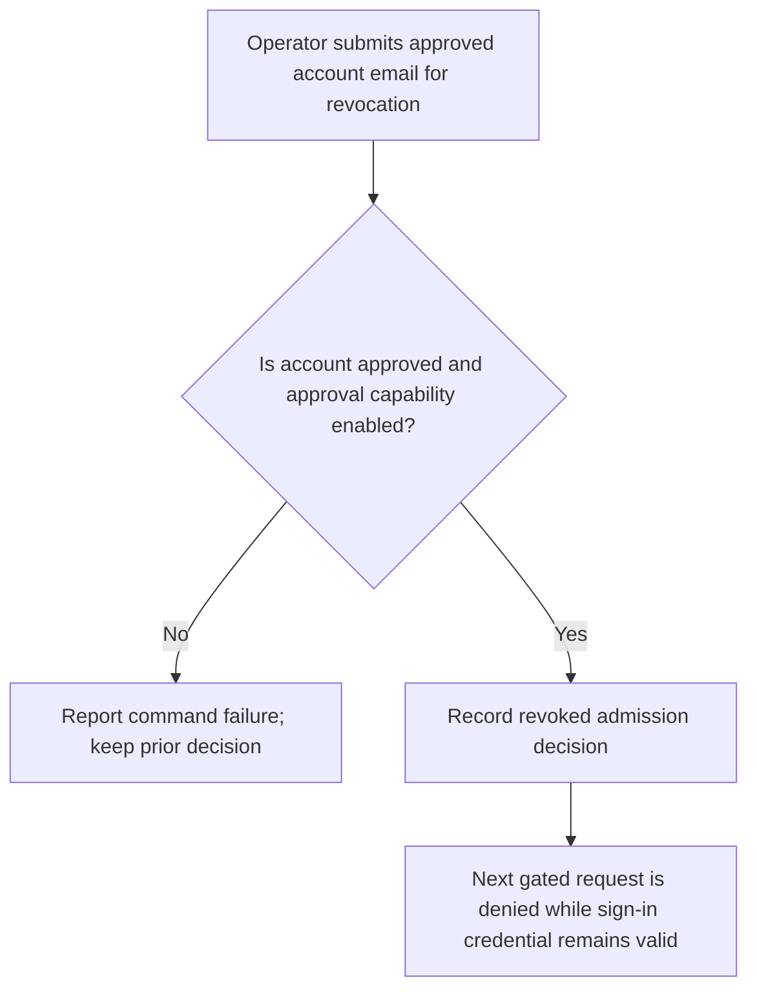
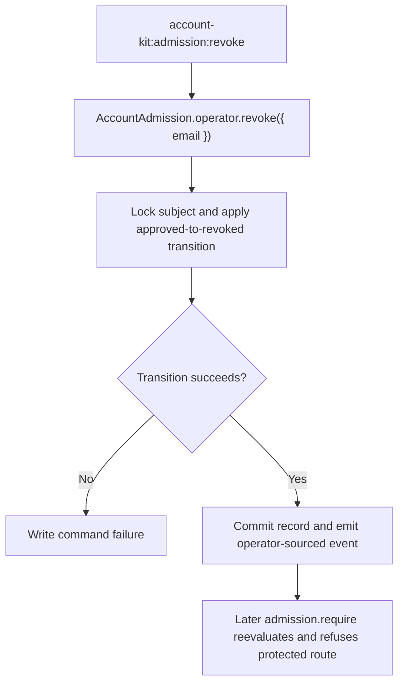

# US-ACCOUNT-50 — Revoke admission as an operator

As an application operator, I want to revoke an approved account from the trusted shell so that it no longer passes the admission gate.

**Status:** Operator
**Access:** Shell access and enabled approval requirement; the account remains able to sign in, but gated application routes reject it.
**Entry:** Run `account-kit:admission:revoke <email>`.
**Documentation:** [Admission operator commands](../docs/guide/admission.md#commands)
**Source:** [`src/admission/operator.ts`](../src/admission/operator.ts)
**Coverage:** [`tests/admission_commands.spec.ts`](../tests/admission_commands.spec.ts)

## Acceptance criteria

- Email identifies an existing account with approved state; success returns updated admission record, stores null actorId and emits operator-source event after commit.
- Missing account, disabled approval or invalid transition is reported; credential/session state is not revoked by this admission decision.

## User flow

## Code flow

Scope: operator admission transition; it does not invalidate sessions.

**Code references:** [`operatorDecision`](../src/admission/operator.ts), [`revoke command`](../src/admission/commands/revoke.ts), [`command tests`](../tests/admission_commands.spec.ts)
