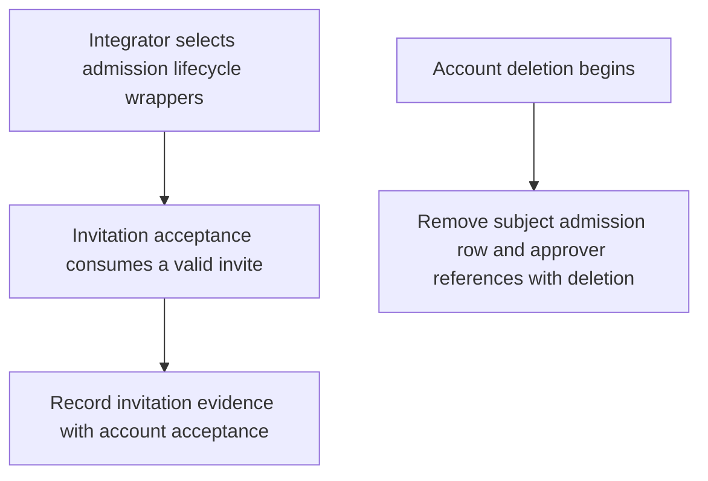
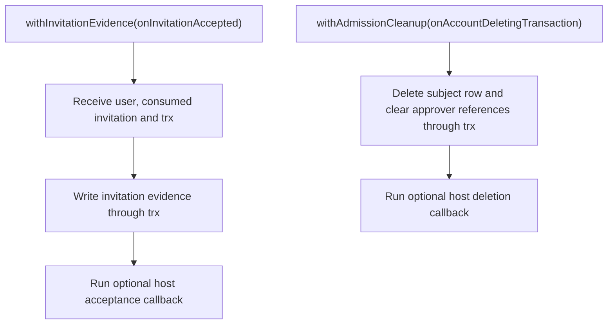

# US-ACCOUNT-51 — Connect invitation evidence and deletion cleanup

As an application integrator, I want admission evidence to follow invitation acceptance and account deletion so that those lifecycle changes keep admission state consistent.

**Status:** Current when admission is installed and host selects the wrappers
**Access:** The host configures lifecycle callbacks; wrappers write through the transaction supplied by Account Kit.
**Entry:** Wrap `onInvitationAccepted` with `withInvitationEvidence(...)` and set `onAccountDeletingTransaction: withAdmissionCleanup(...)` in `config/account_kit.ts`.
**Documentation:** [Admission lifecycle hooks](../docs/guide/admission.md)
**Source:** [`src/admission/invitation_evidence.ts`](../src/admission/invitation_evidence.ts)
**Coverage:** [`tests/admission_cleanup.spec.ts`](../tests/admission_cleanup.spec.ts), [`tests/admission_invitation_evidence.spec.ts`](../tests/admission_invitation_evidence.spec.ts)

## Acceptance criteria

- `withInvitationEvidence(next?)` records the consumed invitation evidence using the acceptance transaction, then invokes the optional host callback. `withAdmissionCleanup(next?)` removes the deleted account's admission row and clears it as approver in the deletion transaction before the optional host callback.
- Host callback writes use the supplied transaction; failure rolls back the associated account lifecycle transaction.

## User flow

## Code flow

Scope: these wrappers participate in their caller's transaction and do not add routes or screens.

**Code references:** [`withInvitationEvidence`](../src/admission/invitation_evidence.ts), [`withAdmissionCleanup`](../src/admission/cleanup.ts), [`admission lifecycle guide`](../docs/guide/admission.md)
