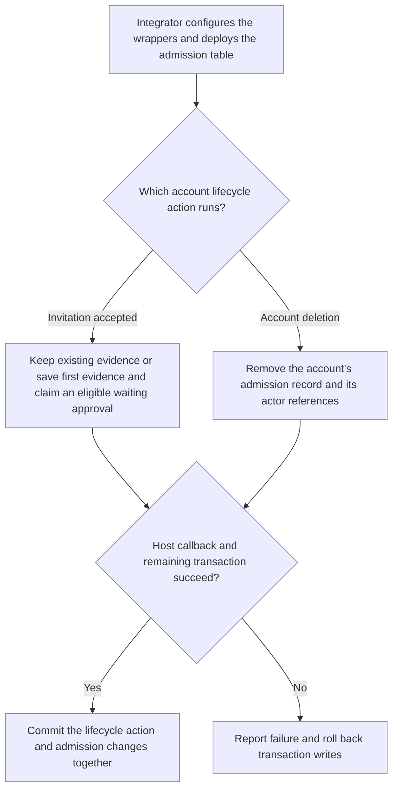
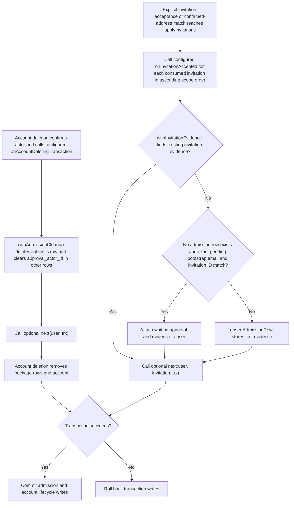

# US-ACCOUNT-51 — Connect invitation evidence and deletion cleanup

As an application integrator, I want admission evidence to follow invitation acceptance and account deletion so that those lifecycle changes keep admission state consistent.

**Status:** Current when admission is installed and host selects the wrappers
**Access:** The host configures lifecycle callbacks; wrappers write through the transaction supplied by Account Kit.
**Entry:** Wrap `onInvitationAccepted` with `withInvitationEvidence(...)` and set `onAccountDeletingTransaction: withAdmissionCleanup(...)` in `config/account_kit.ts` or register those callbacks through `AccountKitCallbackConfiguration`.
**Documentation:** [Admission lifecycle hooks](../docs/guide/admission.md)
**Source:** [`src/admission/invitation_evidence.ts`](../src/admission/invitation_evidence.ts)
**Coverage:** [`tests/admission_cleanup.spec.ts`](../tests/admission_cleanup.spec.ts), [`tests/admission_invitation_evidence.spec.ts`](../tests/admission_invitation_evidence.spec.ts)

## Acceptance criteria

- Supply `onInvitationAccepted: withInvitationEvidence(next?)` and `onAccountDeletingTransaction: withAdmissionCleanup(next?)` inline or through [the Account Kit callback registry](../README.md#registering-callbacks-from-a-provider). The admission table must exist before either wrapper runs. Acceptance records evidence even when the admission invitation requirement is disabled.
- On each consumed invitation, the wrapper keeps existing evidence. For a user with no existing admission row, it can link the waiting approval only if both address and invitation ID match. Otherwise it writes the first evidence on the user's row. The optional `next(user, invitation, trx)` runs even when evidence was already recorded.
- Deletion removes the user's admission row and clears their actor ID from other rows, preserving the others' decisions. The optional `next(user, trx)` runs before account removal. Failure in either wrapper or its callback rolls back writes in the associated transaction.

## User flow

## Code flow

Scope: these wrappers participate in their caller's transaction and do not add routes or screens.

**Code references:** [`withInvitationEvidence`](../src/admission/invitation_evidence.ts), [`withAdmissionCleanup`](../src/admission/cleanup.ts), [`admission lifecycle guide`](../docs/guide/admission.md), [invitation hook caller](../src/invitation_match.ts), [explicit invitation acceptance](../src/invitations.ts), [account deletion](../src/account_deletion.ts), [registry callback resolution](../src/config_resolution.ts)
