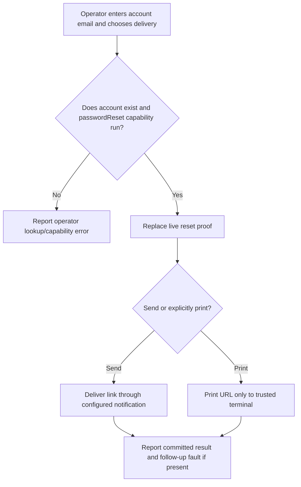
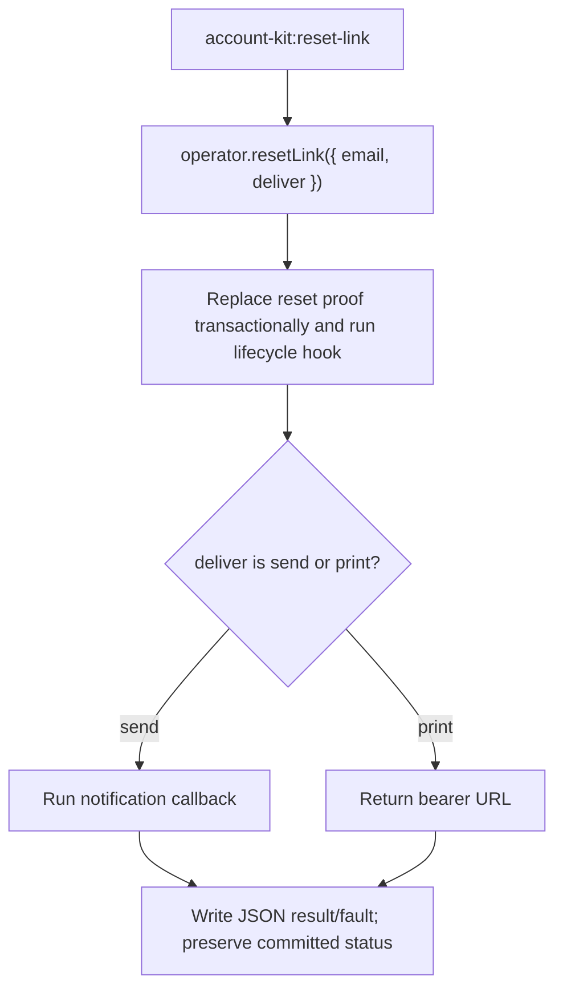

# US-ACCOUNT-52 — Issue a password reset link from the shell

As an application operator, I want to issue a reset link from the trusted shell so that I can help an account holder recover access without exposing a privileged HTTP operation.

**Status:** Operator
**Access:** Shell access and enabled `passwordReset`; command bypasses actor authorization and public request throttles.
**Entry:** Run `account-kit:reset-link <email> [--print]`; default sends through configured notification callback, while `--print` outputs the bearer URL instead.
**Documentation:** [Operator commands](../docs/guide/operations.md#operator-commands)
**Source:** [`commands/reset_link.ts`](../commands/reset_link.ts)
**Coverage:** [`tests/operator_commands.spec.ts`](../tests/operator_commands.spec.ts)

## Acceptance criteria

- Input is email and delivery choice `send` or `print`; service returns user, optional URL and optional committed follow-up fault. Unknown email is reported distinctly rather than using the public generic response. A printed URL is a bearer secret.
- The command replaces the user's live reset link and records a committed result even if delivery/observer follow-up fails; command reports the fault and nonzero outcome without implying rollback.

## User flow

## Code flow

Scope: shell-trusted service invocation; never expose this operator API to HTTP.

**Code references:** [`ResetLink command`](../commands/reset_link.ts), [`operatorResetLink`](../src/operator.ts), [`operator command tests`](../tests/operator_commands.spec.ts)
