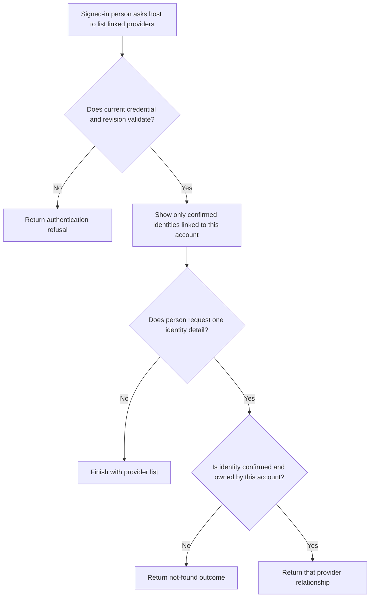
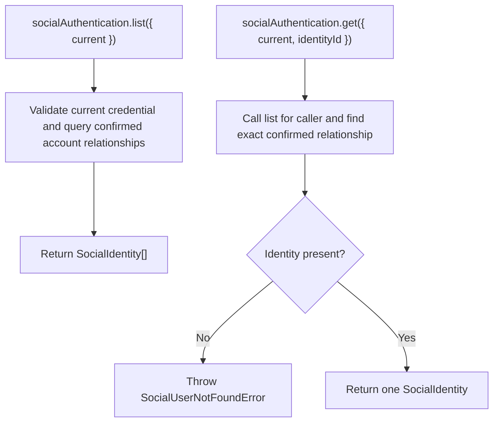

# US-ACCOUNT-53 — Review linked social identities

As a signed-in account holder, I want to review my confirmed provider identities so that I can see which accounts can sign in here.

**Status:** Current when `socialAuthentication` is enabled
**Access:** Current credential and revision are checked; only confirmed relationships owned by this account are returned.
**Entry:** Host calls `socialAuthentication.list({ current })` or `get({ current, identityId })`; no built-in identity settings page is provided.
**Documentation:** [Social authentication](../docs/guide/social-authentication.md)
**Source:** [`src/social_identity.ts`](../src/social_identity.ts)
**Coverage:** [`tests/social_identity_services.spec.ts`](../tests/social_identity_services.spec.ts)

## Acceptance criteria

- `list({ current })` takes `CurrentAccountInput` and returns the caller’s confirmed `SocialIdentity[]`; it excludes pending/unconfirmed relationships. `get` also takes numeric `identityId` and returns one confirmed caller-owned identity.
- A stale credential is refused; `get` of an unknown, unconfirmed or foreign identity returns the same not-found outcome. Displayed provider email is relationship metadata and is never an account-merge key.

## User flow

## Code flow

Scope: authenticated service reads; the host owns representation and any page/control.

**Code references:** [`listSocialIdentities and service list/get`](../src/social_identity.ts), [`social service tests`](../tests/social_identity_services.spec.ts)
