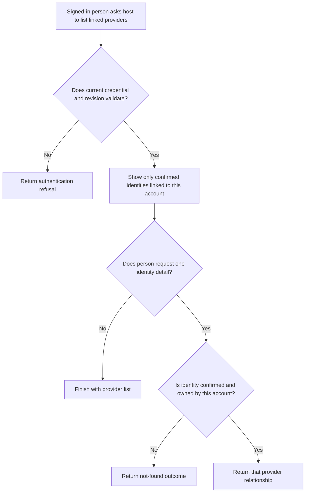
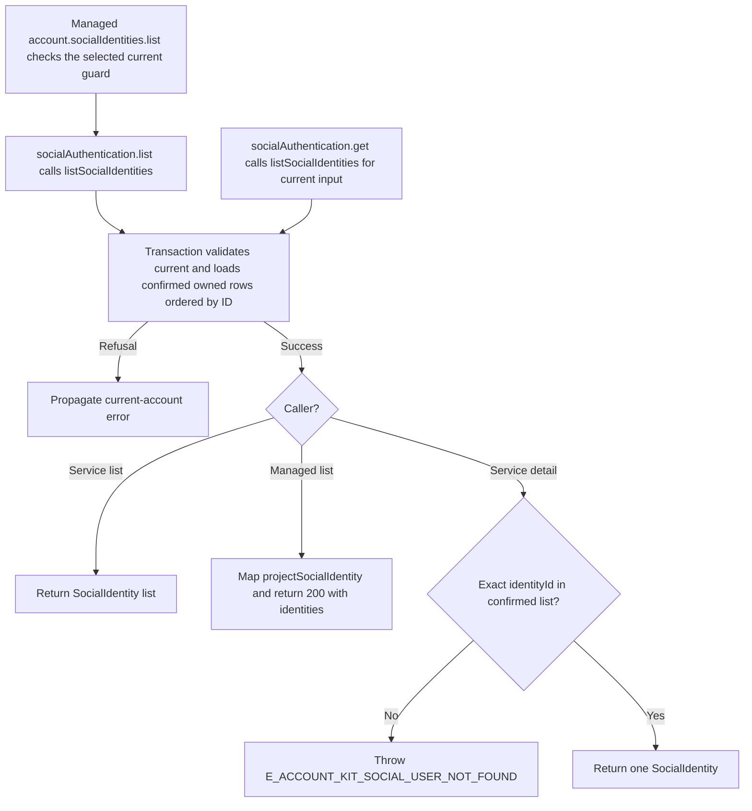

# US-ACCOUNT-53 — Review linked social identities

As a signed-in account holder, I want to review my confirmed provider identities so that I can see which accounts can sign in here.

**Status:** Current when `socialAuthentication` is enabled
**Access:** The configured sign-in must be current. Limited access allows an inactive account to call the list endpoint.
**Entry:** Host calls `socialAuthentication.list({ current })` or `get({ current, identityId })`. Managed GET `account/social-identities` exposes the list.
**Documentation:** [Social authentication](../docs/guide/social-authentication.md)
**Source:** [`src/social_identity.ts`](../src/social_identity.ts)
**Coverage:** [Pending relationship inventory](../tests/social_identity_continuation.spec.ts), [detail lookup](../tests/social_identity_unlink.spec.ts), [managed routes](../tests/managed_social_http.spec.ts)

## Acceptance criteria

- `list({ current })` takes `CurrentAccountInput` and returns the caller’s confirmed `SocialIdentity[]` ordered by ID and excludes pending relationships. The service returns `id`, `userId`, `provider`, `providerUserId`, `email` and `emailVerified`. `get` also takes numeric `identityId` and returns one confirmed caller-owned identity.
- Managed GET returns 200 `{ identities }` with `id`, `provider`, `email` and `emailVerified` per item.
- A stale credential is refused; `get` of an unknown, unconfirmed or foreign identity returns the same not-found outcome. Displayed provider email is relationship metadata and is never an account-merge key.

## User flow

## Code flow

Scope: managed list response and the host service’s list and detail results.

**Code references:** [service entry and detail lookup](../src/social_identity.ts), [confirmed relationship query](../src/social_links.ts), [managed execution](../src/http/managed_execution.ts), [managed list projection](../src/http/managed_social_account_handlers.ts), [inventory test](../tests/social_identity_continuation.spec.ts)
