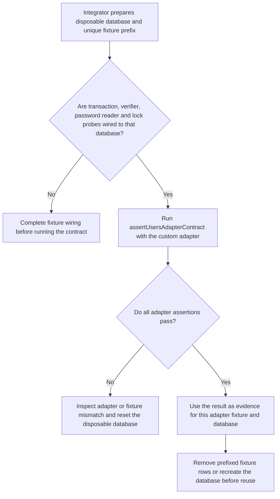
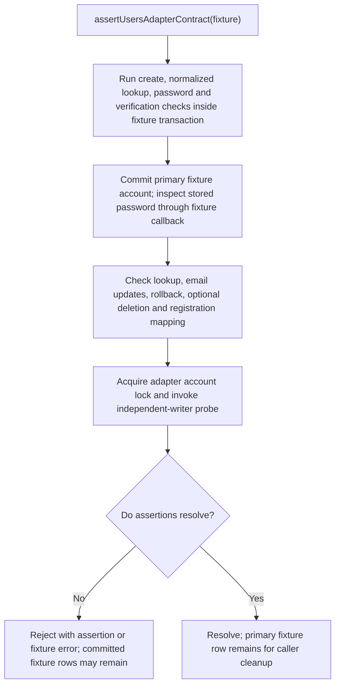

# US-ACCOUNT-54 — Check a custom user adapter contract

As an application integrator, I want to exercise my custom user adapter against Account Kit's contract so that I can find mapping, persistence and locking mismatches before relying on it.

**Status:** Current for adapter integration tests
**Access:** The test fixture needs an isolated disposable database, a unique email prefix, and callbacks for transactions, password verification, stored-password inspection and row-lock probes. The helper commits fixture records and may leave them after a failure or interruption.
**Entry:** Import `assertUsersAdapterContract` from `@kevinjohn/adonisjs-account-kit/testing/adapter_contract` and pass the adapter plus the required fixture callbacks.
**Documentation:** [Custom adapter recipe](../docs/recipes/custom-adapter.md), [adapter guide](../docs/guide/adapters.md)
**Source:** [`testing/adapter_contract.ts`](../testing/adapter_contract.ts), [`package.json` export](../package.json)
**Coverage:** [`tests/lucid_adapter.spec.ts`](../tests/lucid_adapter.spec.ts), [`tests/drizzle_adapter.spec.ts`](../tests/drizzle_adapter.spec.ts), [`tests/prisma_adapter.spec.ts`](../tests/prisma_adapter.spec.ts), [`tests/sql_adapter.spec.ts`](../tests/sql_adapter.spec.ts)

## Acceptance criteria

- **Inputs and result:** `assertUsersAdapterContract(fixture)` receives a `UsersAdapter`, transaction runner, `storedPassword`, `verifyPassword`, `acquireAccountLock`, `assertLockBlocksWriter`, and optional unique `emailPrefix`, registration data, string-ID setting and registration-update assertions. It resolves when the contract assertions pass; assertion failures reject. The helper exercises normalized lookup/create, password verification and non-plaintext storage, verification timestamps, update/rollback behavior, optional prepared-hash and registration-update paths when supplied, deletion when supported, and row locking through an independent writer. It is not a dry run: it commits fixture accounts and updates. Optional deletion removes only the inactive fixture and its recreation; the primary fixture remains, and cleanup is not guaranteed after failure or interruption.
- **Environment and cleanup:** Run only against a dedicated disposable database with the same schema and connection arrangement as the adapter. Before reuse, remove all rows tied to the run's unique prefix or recreate the database, including after an interrupted test. A passing helper call is test evidence for the supplied fixture and database, not a claim that every application runtime combination was tested.

## User flow

## Code flow

**Code references:** [`assertUsersAdapterContract`](../testing/adapter_contract.ts), [custom adapter recipe](../docs/recipes/custom-adapter.md), [`Lucid fixture`](../tests/lucid_adapter.spec.ts), [`Drizzle fixtures`](../tests/drizzle_adapter.spec.ts), [`Prisma fixtures`](../tests/prisma_adapter.spec.ts), [`SQL fixtures`](../tests/sql_adapter.spec.ts)
