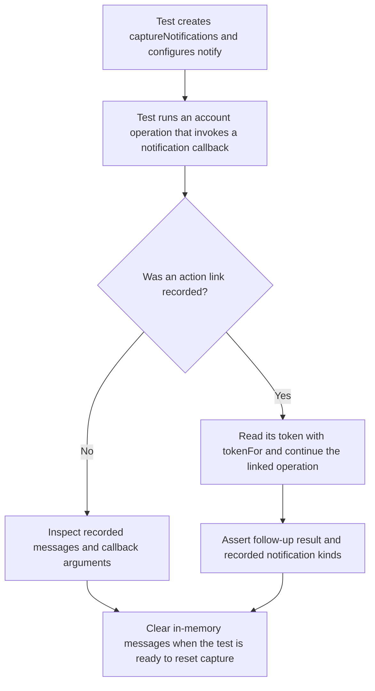
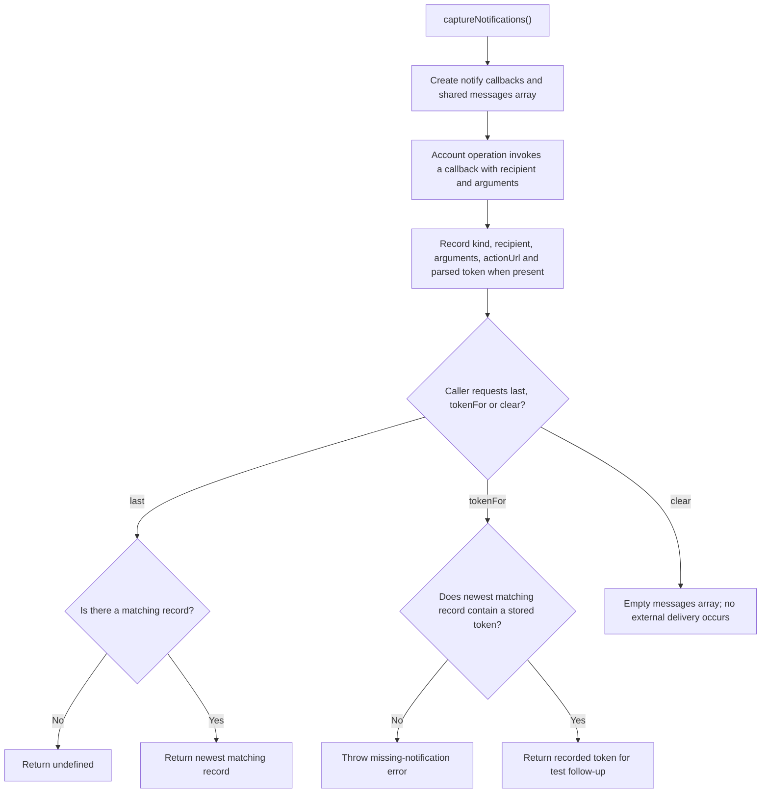

# US-ACCOUNT-55 — Capture account notifications in tests

As an application developer, I want to capture Account Kit notification callbacks in memory so that I can inspect action links and exercise the corresponding operation in tests without sending mail.

**Status:** Current for application tests
**Access:** The helper stores messages only in the current process; it does not deliver mail, persist an outbox or prove recipient delivery.
**Entry:** Import `captureNotifications` from `@kevinjohn/adonisjs-account-kit/testing/notifications` and pass its `notify` callbacks to Account Kit configuration.
**Documentation:** [Testing recipe](../docs/recipes/testing.md), [notification guide](../docs/guide/notifications.md)
**Source:** [`testing/notifications.ts`](../testing/notifications.ts), [`package.json` export](../package.json)
**Coverage:** [`tests/testing_notifications.spec.ts`](../tests/testing_notifications.spec.ts), [`tests/package_exports.spec.ts`](../tests/package_exports.spec.ts)

## Acceptance criteria

- **Inputs and result:** `captureNotifications()` returns `notify`, an in-memory `messages` array, `last(kind, to?)`, `tokenFor(kind, to?)` and `clear()`. The callbacks record notification kind, recipient, raw arguments and, for action links, the URL and parsed token. `last` returns the newest matching kind/recipient or `undefined` when there is no match. `tokenFor` returns the stored token from that newest matching message and throws when no matching message or token exists; it does not search older matching messages. `clear()` empties the shared array. Passing `notify` to an account operation records callbacks for tests; it neither sends nor queues a message.
- **Test outcome:** A test can take a recorded proof token and call the matching account operation, then assert the resulting notifications. Observing the in-memory callback proves callback execution in that test only; it does not prove delivery, durable storage or production transport behavior.

## User flow

## Code flow

Scope: the `captureNotifications` test helper only. The account operation that calls a notification callback, and the test's own assertions, stay outside this diagram.

**Code references:** [`captureNotifications`](../testing/notifications.ts), [testing recipe](../docs/recipes/testing.md), [`capture helper tests`](../tests/testing_notifications.spec.ts), [`export tests`](../tests/package_exports.spec.ts)
