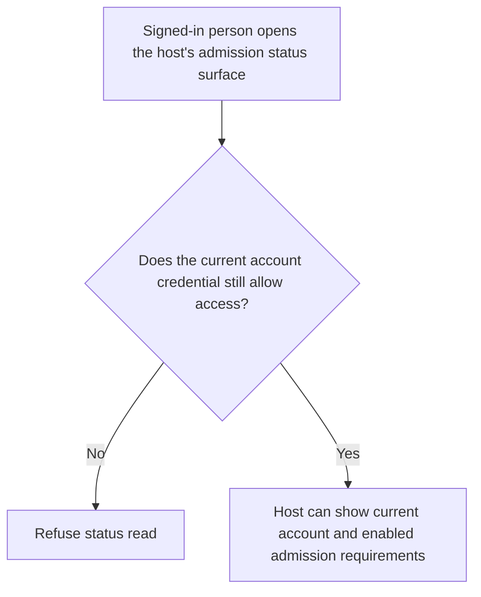
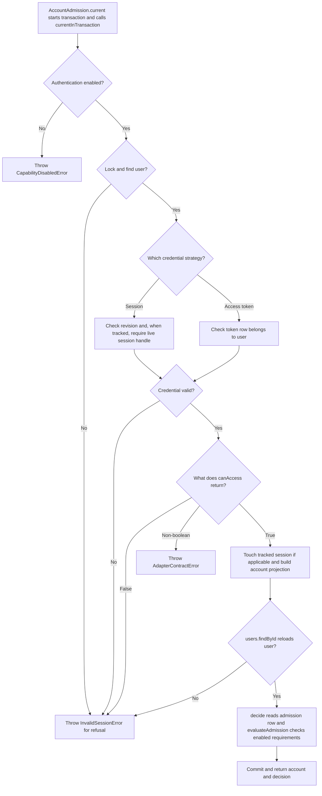

# US-ACCOUNT-56 — Read current admission status

As a signed-in account holder, I want the application to show my admission status before full access so that I know whether I can continue or need approval.

**Status:** Current when the admission module is installed
**Access:** A valid current credential is required. This read does not require an active account or an admitted decision; the host owns the limited status surface.
**Entry:** Host passes its authenticated guard's `CurrentAccountInput` to `AccountAdmission.current(input)`.
**Documentation:** [Admission](../docs/guide/admission.md)
**Source:** [`src/admission/service.ts`](../src/admission/service.ts)
**Coverage:** [`tests/admission_gate.spec.ts`](../tests/admission_gate.spec.ts), [`tests/admission_request.spec.ts`](../tests/admission_request.spec.ts)

## Acceptance criteria

- `current(input)` checks the guard evidence and evaluates admission in one transaction, returning `{ account, decision }`. Session evidence is `userId` and the current `revision` (explicit `null` before the first revision change), plus `sessionHandle` when sign-in tracking is enabled. Access-token evidence is `userId` and `tokenId` for the user's token. A valid tracked session can have its activity updated.
- Unknown users, invalid or revoked credentials, and accounts refused by `authentication.canAccess(user, trx)` fail with `InvalidSessionError`. A non-boolean access decision throws `AdapterContractError`. An account may be inactive or lack admission and still receive status. The decision contains only enabled requirements and the combined `admitted` result. The host controls what it displays and applies the [protected-route gate](US-ACCOUNT-25-gate-application-route.md) separately.

## User flow

## Code flow

Scope: Account Kit validates the supplied credential and evaluates admission; the host provides the status route. With tracked sessions, current-credential validation may update session activity metadata.

**Code references:** [`AccountAdmission.current` and `decide`](../src/admission/service.ts), [`currentInTransaction`](../src/authentication.ts), [`admission gate tests`](../tests/admission_gate.spec.ts), [requirement evaluation](../src/admission/decision.ts), [credential types](../src/types_authentication.ts), [access decision validation](../src/account_access_decision.ts)
