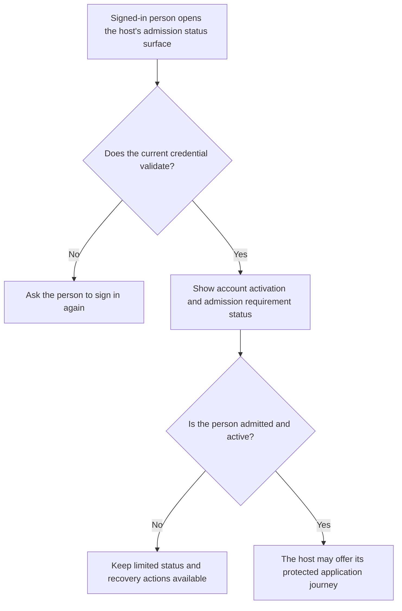
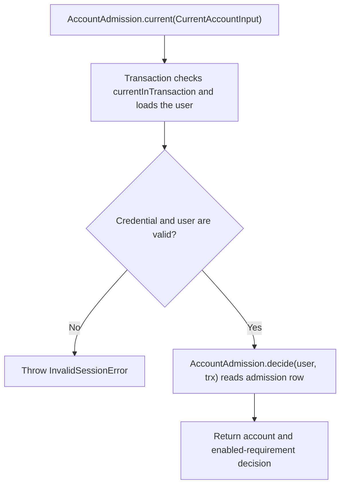

# US-ACCOUNT-56 — Read current admission status

As a signed-in account holder, I want the application to show my admission status before full access so that I know whether I can continue or need approval.

**Status:** Current when the admission module is installed
**Access:** A valid current credential is required. This read does not require an active account or an admitted decision; the host owns the limited status surface.
**Entry:** Host passes its authenticated guard's `CurrentAccountInput` to `AccountAdmission.current(input)`.
**Documentation:** [Admission](../docs/guide/admission.md)
**Source:** [`src/admission/service.ts`](../src/admission/service.ts)
**Coverage:** [`tests/admission_gate.spec.ts`](../tests/admission_gate.spec.ts), [`tests/admission_request.spec.ts`](../tests/admission_request.spec.ts)

## Acceptance criteria

- `current(input)` checks the current credential and returns `{ account, decision }` in one transaction. The decision reports enabled admission requirements; this is not the protected-route gate and does not require `account.active` or `decision.admitted`.
- Invalid or revoked credentials fail with `InvalidSessionError`. A host may use the result on a limited surface and must still apply `require` or its gate to protected actions.

## User flow

## Code flow

Scope: Account Kit validates the supplied credential and evaluates admission; the host provides the status route. With tracked sessions, current-credential validation may update session activity metadata.

**Code references:** [`AccountAdmission.current` and `decide`](../src/admission/service.ts), [`currentInTransaction`](../src/authentication.ts), [`admission gate tests`](../tests/admission_gate.spec.ts)
