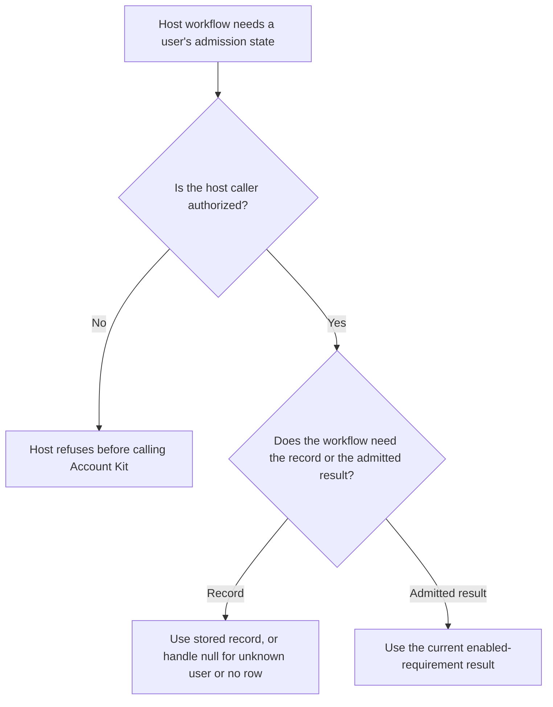
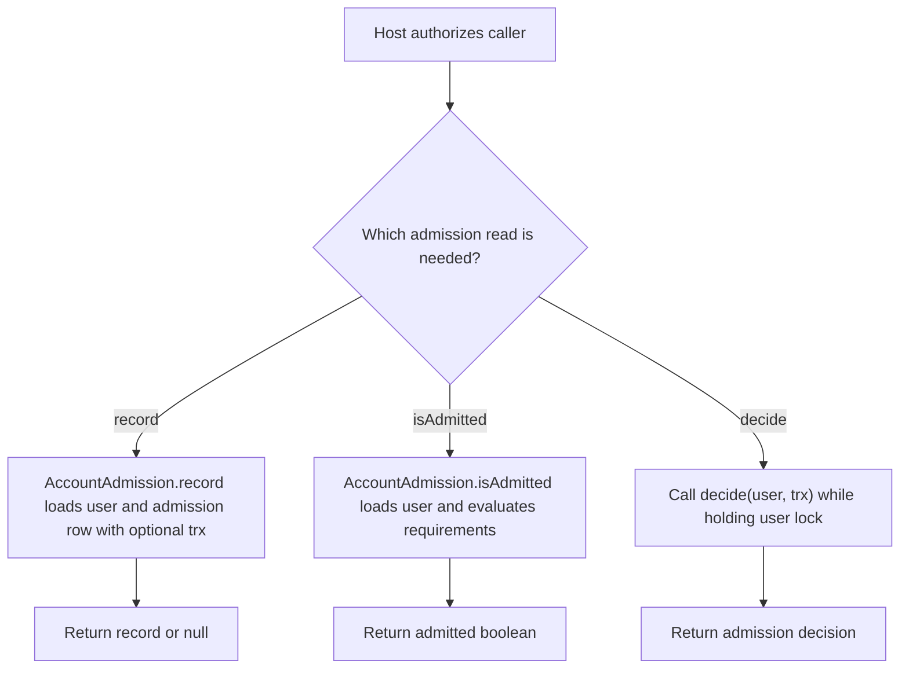

# US-ACCOUNT-57 — Check a user's admission record

As an application developer, I want to check admission state inside my authorized workflow so that I can make an application decision using current or transaction-local evidence.

**Status:** Current when the admission module is installed
**Access:** The host must authorize the caller before invoking user-ID lookups. `decide(user, trx)` requires the caller to hold the user lock in `trx`; `record` and `isAdmitted` accept an optional transaction to include its uncommitted writes.
**Entry:** Host code calls `AccountAdmission.record(userId, trx?)`, `isAdmitted(userId, trx?)`, or `decide(user, trx)`.
**Documentation:** [Admission](../docs/guide/admission.md)
**Source:** [`src/admission/service.ts`](../src/admission/service.ts)
**Coverage:** [`tests/admission_record.spec.ts`](../tests/admission_record.spec.ts), [`tests/admission_decision.spec.ts`](../tests/admission_decision.spec.ts), [`tests/admission_invitation_evidence.spec.ts`](../tests/admission_invitation_evidence.spec.ts)

## Acceptance criteria

- `record` returns the stored admission record or `null` for an unknown user or missing row. `isAdmitted` evaluates the enabled requirements and returns `false` for an unknown user; it does not validate a credential or require an active account unless an enabled requirement does.
- Passing the host's transaction lets `record` and `isAdmitted` observe its uncommitted admission writes. `decide(user, trx)` evaluates a loaded user using that transaction and requires the caller to hold the user lock.
- These lookups do not authenticate or authorize the caller; the host owns that boundary.

## User flow

## Code flow

Scope: host authorization precedes these service methods; `decide` is evaluated within a caller-owned transaction and lock.

**Code references:** [`AccountAdmission.record`, `isAdmitted` and `decide`](../src/admission/service.ts), [`record tests`](../tests/admission_record.spec.ts), [`decision tests`](../tests/admission_decision.spec.ts)
