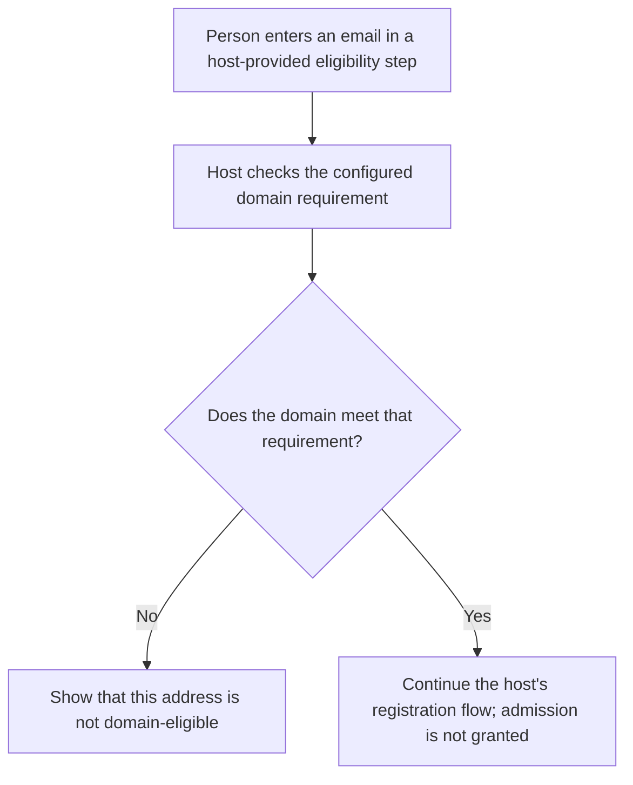
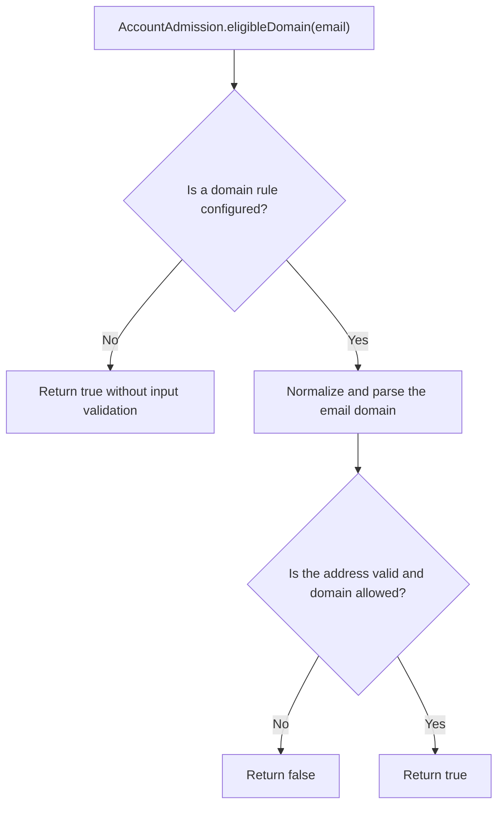

# US-ACCOUNT-58 — Check admission domain eligibility

As an application developer, I want to check whether an email meets the configured admission domain rule so that I can guide a person before confirmation.

**Status:** Current when the admission module is installed
**Access:** Host decides where to expose this preflight; it does not authenticate a person or grant admission.
**Entry:** Host code calls `AccountAdmission.eligibleDomain(email)`.
**Documentation:** [Admission](../docs/guide/admission.md)
**Source:** [`src/admission/service.ts`](../src/admission/service.ts)
**Coverage:** [`tests/admission_decision.spec.ts`](../tests/admission_decision.spec.ts)

## Acceptance criteria

- When a domain requirement is disabled, `eligibleDomain` returns `true` before validating the input. When enabled, a malformed address or a domain outside the configured rule returns `false`; a matching domain returns `true`.
- This preflight does not check invitation or approval requirements, confirm an address, or admit an account. The host still applies registration and admission policy.

## User flow

## Code flow

Scope: this pure preflight checks only the configured domain rule; the host owns email collection and later registration/admission decisions.

**Code references:** [`AccountAdmission.eligibleDomain`](../src/admission/service.ts), [`domain helpers`](../src/admission/domain.ts), [`eligibility tests`](../tests/admission_decision.spec.ts)
