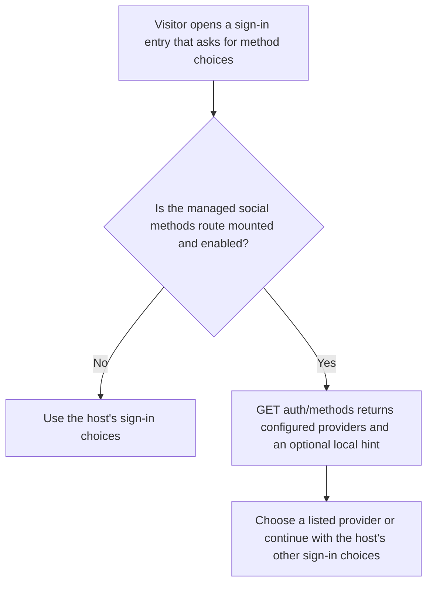
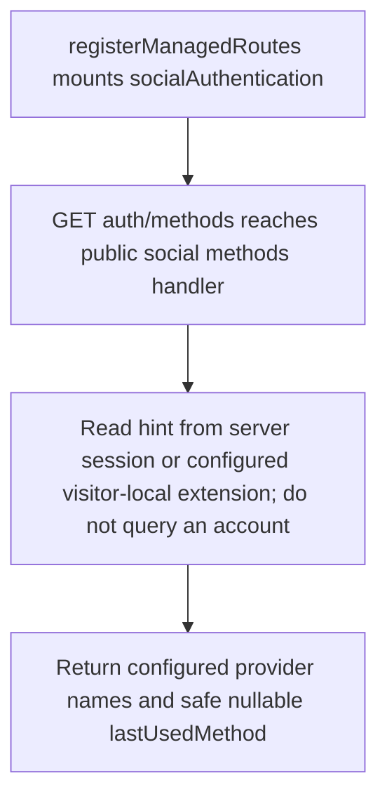

# US-ACCOUNT-59 — Discover available authentication methods

As a visitor, I want to see which authentication methods are available so that I can choose a sign-in path without revealing an account lookup.

**Status:** Current when `socialAuthentication` and its public managed `auth.methods` route are enabled and mounted
**Access:** Public; returns configured provider names and an optional visitor-local `lastUsedMethod` hint, never account data.
**Entry:** `GET auth/methods` on the mounted managed social route group.
**Documentation:** [Managed social routes](../docs/guide/managed-social.md#last-used-method)
**Source:** [`src/http/managed_social_account_handlers.ts`](../src/http/managed_social_account_handlers.ts), [`src/http/routes.ts`](../src/http/routes.ts)
**Coverage:** [`tests/managed_social_http.spec.ts`](../tests/managed_social_http.spec.ts)

## Acceptance criteria

- The public endpoint returns enabled provider names and nullable `lastUsedMethod` without looking up an account.
- The hint is allowlisted to `password` or an enabled provider and is only a visitor-local preference; it cannot identify or authorize an account. It appears only when the application mounts the method endpoint and the selected strategy records it after successful sign-in.

## User flow

## Code flow

Scope: public managed route and visitor-local hint resolution; the host owns the sign-in screen.

**Code references:** [`managed social handler`](../src/http/managed_social_account_handlers.ts), [`social route registration`](../src/http/routes.ts), [`managed social tests`](../tests/managed_social_http.spec.ts)
