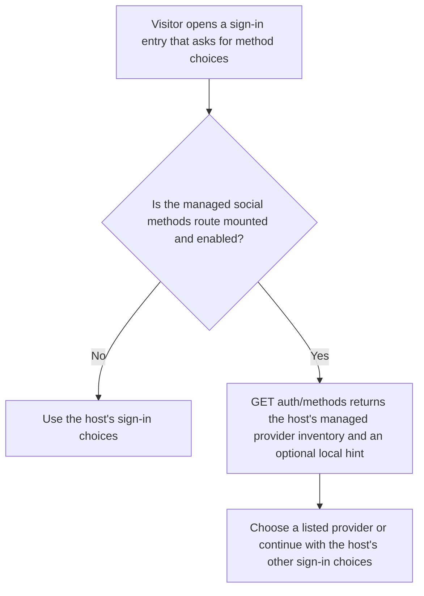
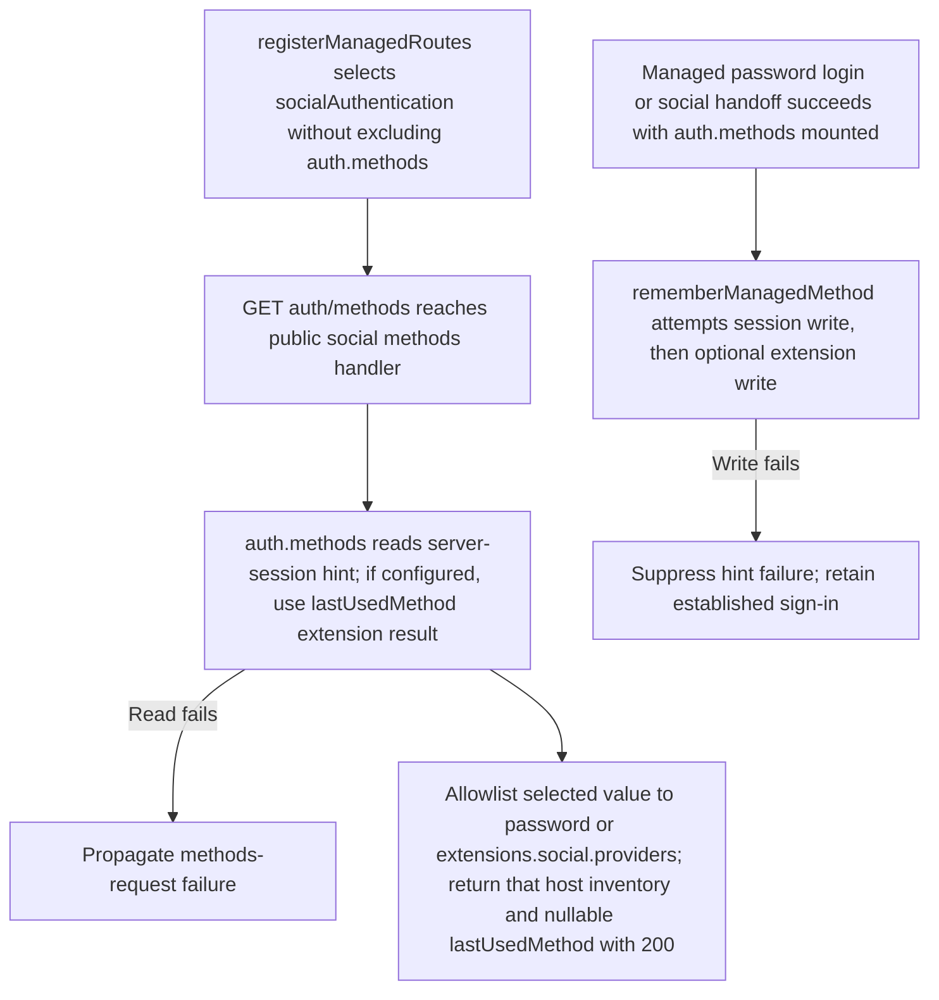

# US-ACCOUNT-59 — Discover available authentication methods

As a visitor, I want to see which authentication methods are available so that I can choose a sign-in path without revealing an account lookup.

**Status:** Current when `socialAuthentication` and its public managed `auth.methods` route are enabled and mounted
**Access:** Public; returns the host-supplied `extensions.social.providers` inventory and an optional visitor-local `lastUsedMethod` hint, never account data.
**Entry:** `GET auth/methods` on the mounted managed social route group.
**Documentation:** [Managed social routes](../docs/guide/managed-social.md#last-used-method)
**Source:** [`src/http/managed_social_account_handlers.ts`](../src/http/managed_social_account_handlers.ts), [`src/http/routes.ts`](../src/http/routes.ts)
**Coverage:** [`tests/managed_social_http.spec.ts`](../tests/managed_social_http.spec.ts)

## Acceptance criteria

- The public endpoint returns `extensions.social.providers` and nullable `lastUsedMethod` without looking up an account. Registration validates supported, unique names but does not compare this managed inventory with the service's configured providers. The host must align them; a listed but unconfigured provider is refused when [sign-in begins](US-ACCOUNT-20-social-sign-in.md#code-flow).
- The handler reads the session hint and uses the host’s `lastUsedMethod(context)` result instead when configured. It allowlists the selected value to `password` or one of `extensions.social.providers`, with `null` for an absent or unrecognised selection.
- When the endpoint is mounted, successful managed password login or a managed social credential handoff attempts to remember the visitor-local hint in the session and then via optional `rememberLastUsedMethod(context, method)`. A session write failure skips the extension write; either failure leaves the completed sign-in valid. A failure reading the hint, including from `lastUsedMethod`, propagates from the methods request.

## User flow

## Code flow

Scope: public managed route and visitor-local hint resolution; the host owns the sign-in screen.

**Code references:** [`managed social handler`](../src/http/managed_social_account_handlers.ts), [social route registration](../src/http/routes.ts), [managed mounting and methods flag](../src/http/managed.ts), [password hint producer](../src/http/handlers_authentication.ts), [social hint producers](../src/http/social.ts), [hint writer](../src/http/last_used_method.ts), [`managed social tests`](../tests/managed_social_http.spec.ts)
