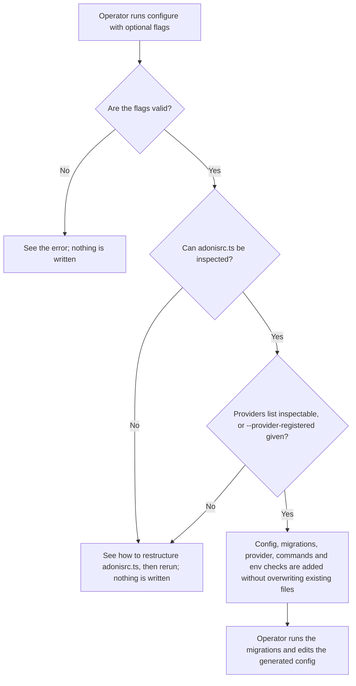
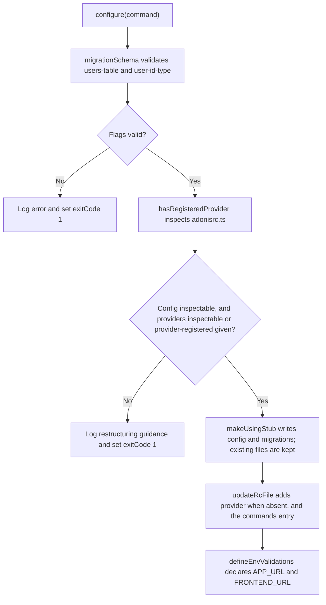

# US-ACCOUNT-60 — Install the Account Kit package

As an application operator, I want to run the package's configure step so that a new AdonisJS application gets the Account Kit config, migrations, provider and commands without hand-writing them.

**Status:** Operator
**Access:** Requires shell access to the application. The step never overwrites existing files; the operator still runs the migrations and reviews the generated config.
**Entry:** Run `node ace configure @kevinjohn/adonisjs-account-kit [--users-table] [--user-id-type] [--provider-registered]`; `node ace add` runs the same step. [US-ACCOUNT-31](US-ACCOUNT-31-configure-account-kit.md) covers the later `account-kit:setup` action.
**Documentation:** [getting-started.md](../docs/guide/getting-started.md)
**Source:** [`configure.ts`](../configure.ts), exported as `configure` from [`index.ts`](../index.ts)
**Coverage:** [`tests/configure.spec.ts`](../tests/configure.spec.ts), [`tests/configure_contract.spec.ts`](../tests/configure_contract.spec.ts)

## Acceptance criteria

| Field                   | Control      | Required/default/conditions                                                                                                                                                                        |
| ----------------------- | ------------ | -------------------------------------------------------------------------------------------------------------------------------------------------------------------------------------------------- |
| `--users-table`         | String flag  | Optional; defaults to `users`. Must be a plain SQL identifier, otherwise the step stops with exit code 1 before any write.                                                                         |
| `--user-id-type`        | String flag  | Optional; defaults to `integer`. Allowed values are `integer`, `string` and `uuid`; they set the user-keyed column types in the generated migrations. Anything else stops with exit code 1.        |
| `--provider-registered` | Boolean flag | Optional. Only for an `adonisrc.ts` whose `providers` list cannot be inspected statically: it states that Account Kit is already registered exactly once, and the provider list is left unchanged. |

- The step writes `config/account_kit.ts`, generates the package migrations (skipping any whose migration file already exists, with a `Skipped` message), adds the `account_kit_provider` provider unless it is already registered, adds the package `commands` entry, and declares `APP_URL` and `FRONTEND_URL` in `start/env.ts`.
- Existing application-owned files are not replaced, so a rerun is safe.
- An `adonisrc.ts` whose `defineConfig` call, config properties or syntax cannot be inspected (not a static object literal, computed properties, spreads that do not expose `providers` and `commands`, TypeScript syntax errors) stops with exit code 1 and guidance, whatever the flags. A `providers` list that cannot be inspected stops the same way unless `--provider-registered` is given.

## User flow

## Code flow

Scope: the exported `configure` function and its Assembler codemods. The host owns running migrations and editing the generated config.

**Code references:** [`configure`](../configure.ts), [`migrationSchema`](../src/setup/migration_definitions.ts), [`providers inspection`](../src/setup/providers_inspection.ts), [`config stub`](../stubs/config/account_kit.stub), [`tests/configure.spec.ts`](../tests/configure.spec.ts)
