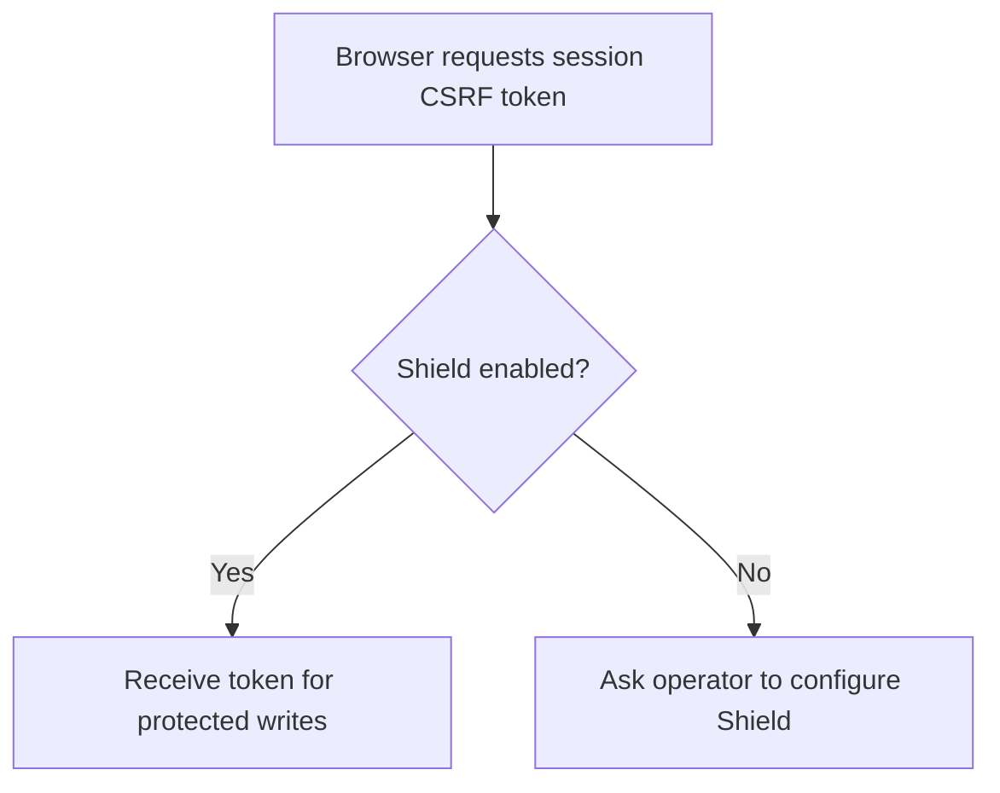
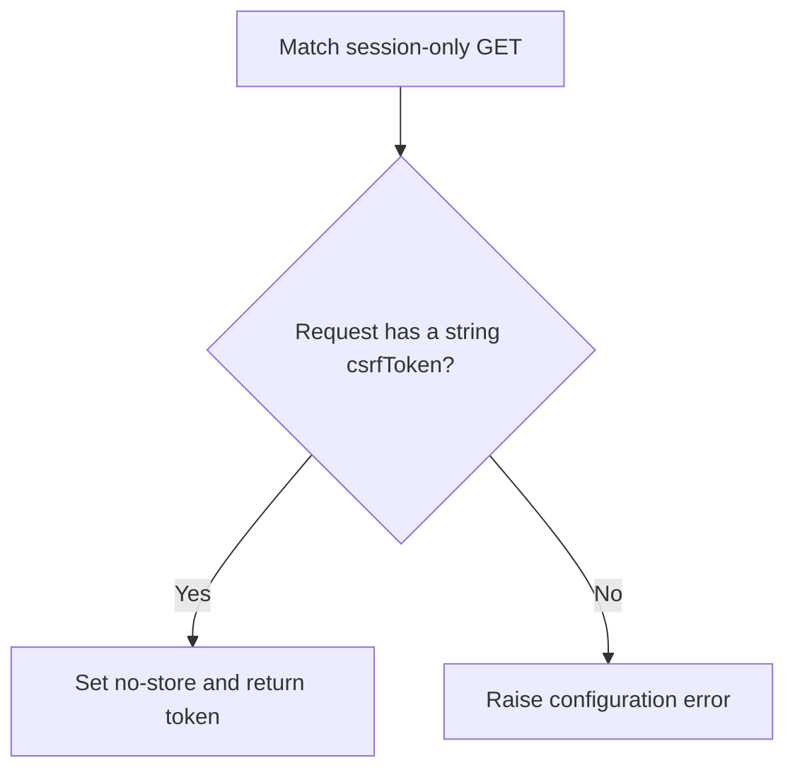

# US-ACCOUNT-61 — Obtain a session CSRF token

As a browser client, I want the CSRF token for my session so that I can submit protected writes.

**Status:** Current

**Access:** Public session route under the authentication capability.

**Entry:** `GET auth/csrf`

**Documentation:** [Guide](../docs/guide/managed-http.md)

**Source:** [src/http/managed_execution.ts](../src/http/managed_execution.ts), [src/http/handlers_authentication.ts](../src/http/handlers_authentication.ts)

**Coverage:** [tests/managed_http_authentication.spec.ts](../tests/managed_http_authentication.spec.ts)

## Acceptance criteria

- Shield supplies a string on the request. The handler sends status 200, an object containing csrfToken and Cache-Control: no-store.
- Missing Shield CSRF middleware raises a configuration error before the handler runs. The access-token route set omits this endpoint.

## User flow

## Code flow

