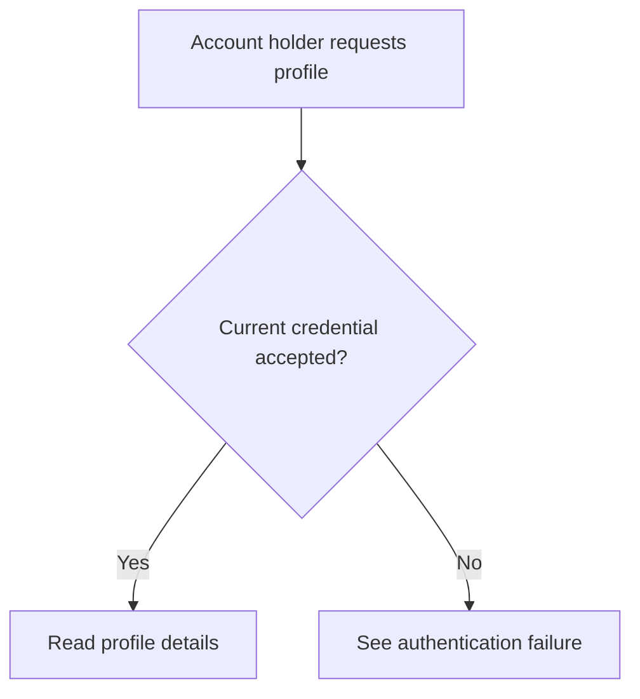
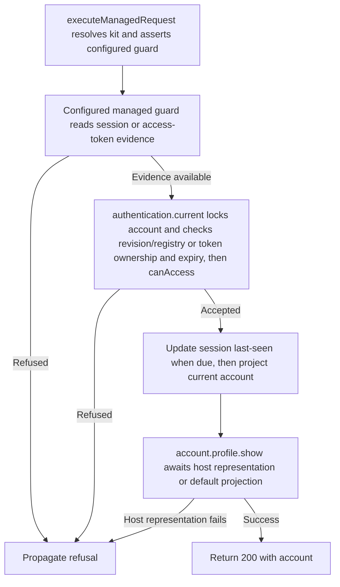

# US-ACCOUNT-62 — Read my managed profile

As a signed-in account holder, I want to read the representation exposed by my application so that I can display my current details.

**Status:** Current

**Access:** Limited-access route under the authentication capability.

**Entry:** `account.profile.show` (GET `account/profile`) under the configured managed prefix.

**Documentation:** [Guide](../docs/guide/managed-http.md)

**Source:** [src/http/managed_execution.ts](../src/http/managed_execution.ts), [src/http/handlers_authentication.ts](../src/http/handlers_authentication.ts)

**Coverage:** [tests/managed_http_authentication.spec.ts](../tests/managed_http_authentication.spec.ts)

## Acceptance criteria

- The guard resolves the current credential and authentication.current loads the account. Limited access allows accounts pending verification to reach this read.
- A stale or refused credential fails before representation. On success the handler returns 200 with account set to the host representation when supplied or the default public representation.
- The default representation returns `id`, `email`, `unverifiedEmail`, `hasPassword` and `active`. A registry-backed session check can update its last-seen timestamp.

## User flow

## Code flow

**Code references:** [managed dispatch](../src/http/managed_execution.ts), [profile handler](../src/http/handlers_authentication.ts), [current account check](../src/authentication.ts), [public projection](../src/http/response_helpers.ts)
