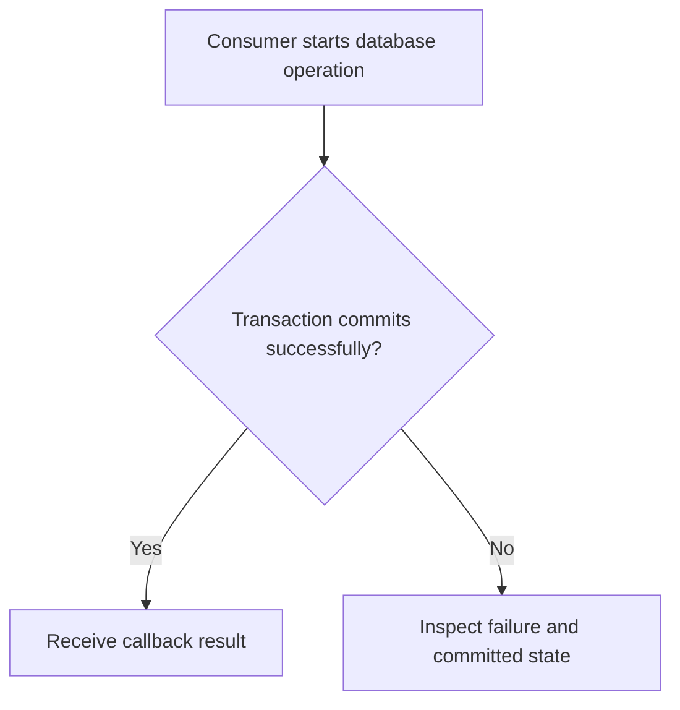
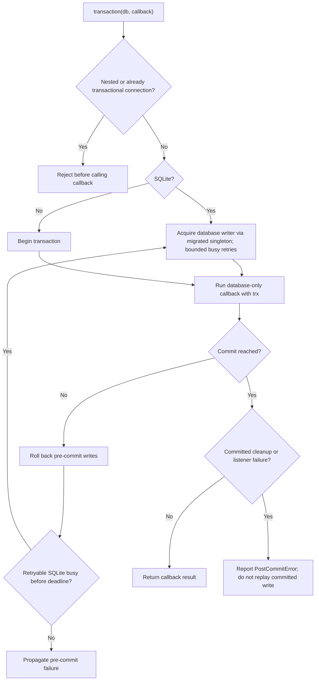

# US-ACCOUNT-63 — Share transaction and timestamp helpers

As a package consumer, I want to use Account Kit’s transaction helpers so that my database integration shares its locking and timestamp conventions.

**Status:** Current

**Access:** Application-owned database integration.

**Entry:** `@kevinjohn/adonisjs-account-kit/transaction`

**Documentation:** [Transaction helpers](../docs/guide/application-owned-integration.md#transaction-helpers-for-packages-built-on-account-kit)

**Source:** [transaction/main.ts](../transaction/main.ts), [src/transaction.ts](../src/transaction.ts)

**Coverage:** [tests/transaction_export.spec.ts](../tests/transaction_export.spec.ts), [tests/transaction_sqlite.spec.ts](../tests/transaction_sqlite.spec.ts)

## Acceptance criteria

- Use `transaction(db, callback)` and the supplied client for database operations. `lockRow(trx, table, id)` uses a row lock on PostgreSQL and MySQL; on SQLite the transaction already holds the writer lock. Use `sqlTimestamp` and `readTimestamp` to round-trip the stored value. Successful commit returns the callback result.
- SQLite requires its migrated singleton lock row. Missing table or row aborts the transaction. A retryable SQLite busy failure before commit can rerun the database-only callback. A post-commit fault reports the committed write, so the caller must avoid replaying it.

## User flow

## Code flow

**Code references:** [transaction](../src/transaction.ts), [lockRow](../src/user_lock.ts), [timestamp helpers](../src/timestamps.ts)
