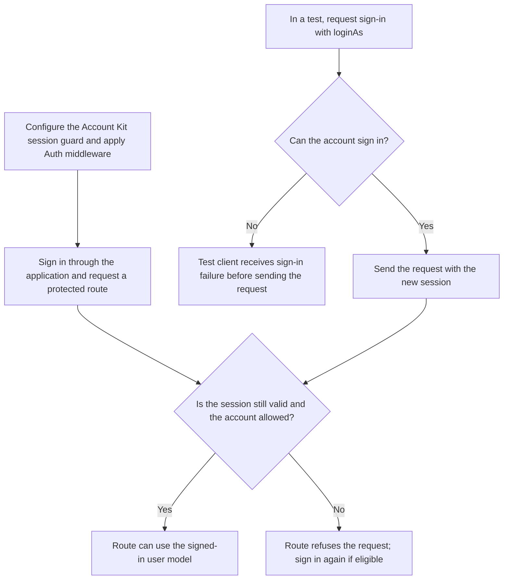
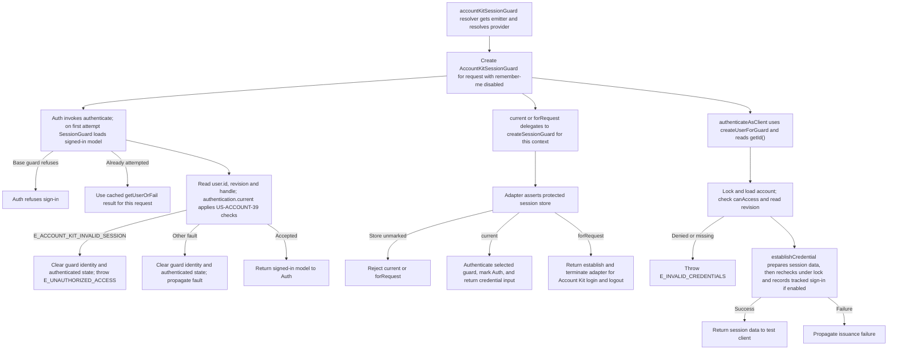

# US-ACCOUNT-64 — Use the Account Kit guard with AdonisJS Auth

As an application developer, I want AdonisJS Auth middleware to use Account Kit's session checks so that application routes can read `auth.user` and refuse revoked sign-ins.

**Status:** Current, opt-in since 0.6.0
**Access:** Requires the optional `@adonisjs/auth` 10 peer, AdonisJS session middleware and Account Kit session authentication. Use the same guard name in Auth and Account Kit. The request helpers require a revocable server-side session marked by `protectManagedSessionConfig(provider, { verifyStore })`.
**Entry:** In `config/auth.ts`, configure `accountKitSessionGuard({ provider })` from `@kevinjohn/adonisjs-account-kit/auth` and select it in Auth middleware.
**Documentation:** [Account Kit session guard](../docs/guide/authentication.md#account-kit-session-guard)
**Source:** [Auth export](../auth/main.ts), [guard implementation](../src/auth/session_guard.ts)
**Coverage:** [Guard tests](../tests/session_guard.spec.ts), [Japa `loginAs` HTTP test](../tests/session_guard_login_as.spec.ts), [package export tests](../tests/package_exports.spec.ts)

## Acceptance criteria

- `provider` is an AdonisJS session user provider or its configuration provider. Its original user model must expose a string or number `id` that matches the provider’s user ID and the Account Kit adapter’s account ID. The guard disables remember-me tokens. Use `auth.use(name).forRequest()` with Account Kit login and logout to establish and end Account Kit session data.
- Auth middleware can expose the signed-in model as `auth.user` once the revision, tracked handle when enabled, and account access policy pass. A failed Account Kit session check clears the guard's authenticated state and exposes `E_UNAUTHORIZED_ACCESS` for `E_ACCOUNT_KIT_INVALID_SESSION`. Other failures propagate.
- `auth.use(name).current()` returns trusted `CurrentAccountInput` for `authentication.current` or `withCurrent`. It includes a live sign-in handle when session management is enabled. Use a separate active-account check when the route requires one.
- With Japa's Auth and session client plugins, `loginAs(user)` uses `authenticateAsClient(user)` to create a new session sign-in. It checks account existence and `canAccess` before issuing session data, and creates a registry row when session management is enabled.

## User flow

## Code flow

Scope: factory resolution, Auth integration, request adapters and test-client sign-in. See [US-ACCOUNT-39](US-ACCOUNT-39-current-account.md) for shared credential checks and [US-ACCOUNT-03](US-ACCOUNT-03-sign-in.md) and [US-ACCOUNT-04](US-ACCOUNT-04-sign-out.md) for login and logout.

**Code references:** [guard resolution and methods](../src/auth/session_guard.ts), [request adapter](../src/http/managed_session_guard.ts), [store protection](../src/http/session_store_protection.ts), [credential issuance](../src/credential_issuance.ts), [guard tests](../tests/session_guard.spec.ts)
