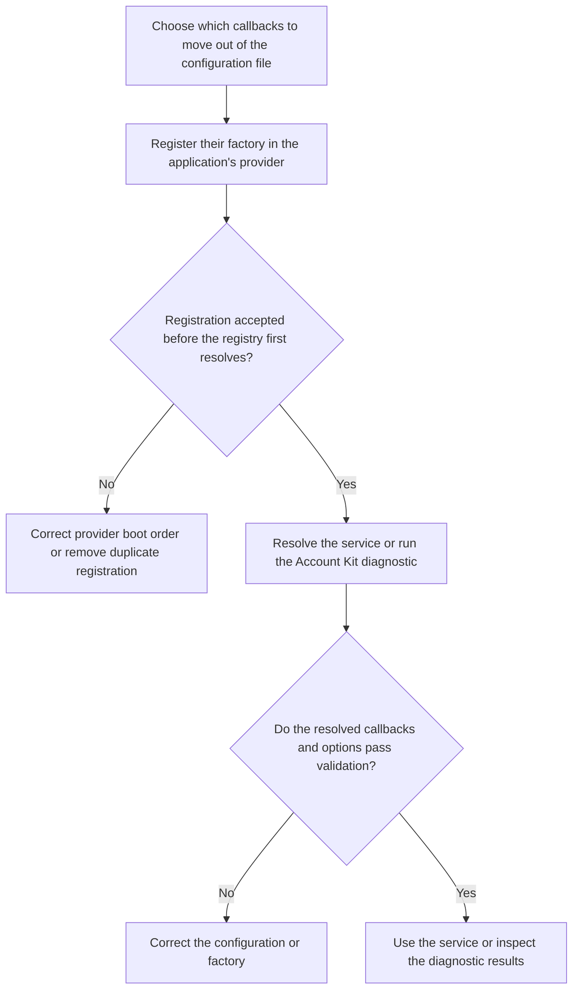
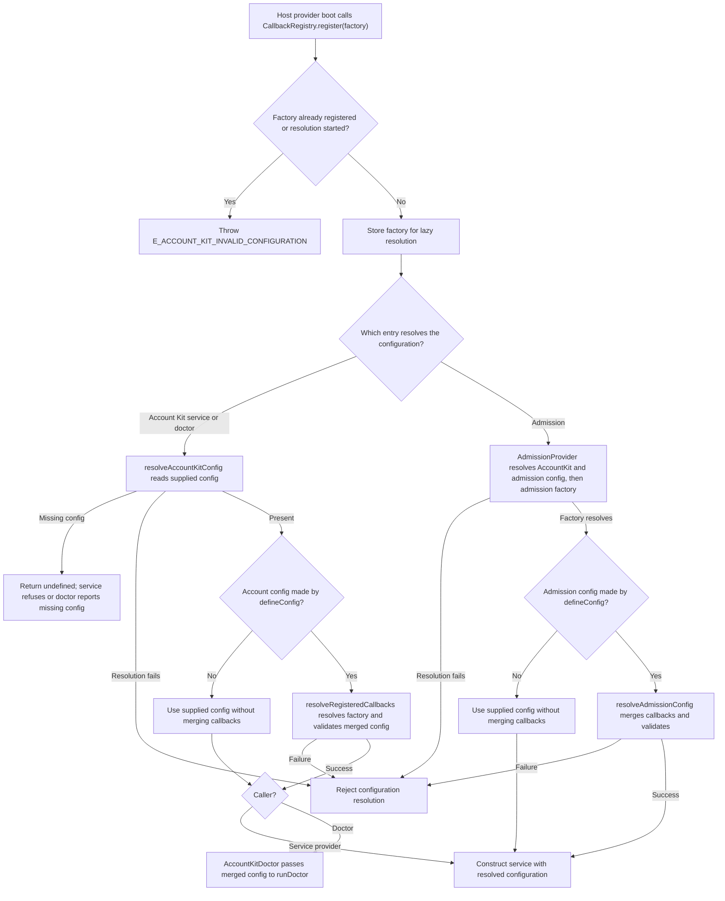

# US-ACCOUNT-65 — Register configuration callbacks from a provider

As an application integrator, I want to register callbacks from an application provider so that my config files can hold options without importing application services.

**Status:** Current with the provider for the service being configured
**Access:** Application boot code, before the target registry first resolves (service startup or Account Kit diagnostics). The admission registry requires the optional admission provider.
**Entry:** In the application provider's `boot()`, resolve `account_kit.callbacks` or `account_admission.callbacks` and call `register(factory)`.
**Documentation:** [Registering callbacks from a provider](../README.md#registering-callbacks-from-a-provider)
**Source:** [Account Kit registry](../src/account_kit_callback_registry.ts), [admission registry](../src/admission/callback_registry.ts)
**Coverage:** [Registry and service resolution tests](../tests/callback_registry.spec.ts)

## Acceptance criteria

- Register one factory per registry. It can return the callback object directly or through a promise. The factory is resolved lazily and the registry caches the result. Resolving Account Kit or running `account-kit:doctor` can trigger Account Kit config resolution.
- The [supported callback keys](../README.md#registering-callbacks-from-a-provider) may be supplied inline or by the registry. Defining the same field in both places fails with `E_ACCOUNT_KIT_INVALID_CONFIGURATION` during resolution. A second registration or a registration after resolution starts fails when called.
- The Account Kit and admission `defineConfig` helpers check inline options first. Service resolution checks the final required callbacks, including the `users` adapter, invitation callbacks for enabled invitations and `approval.authorize` for enabled approval. The admission registry can supply the authoriser but enabling approval remains a config choice. An inline-only configuration still works with an empty registry.
- The Account Kit config provider merges registered callbacks during resolution. Admission merges them when the config was built by its `defineConfig`. A missing Account Kit config returns before its registry resolves.
- The factory runs while the package service is being built, so application services that depend on `AccountKit` or `AccountAdmission` are resolved inside the callbacks, not in the factory body.

## User flow

## Code flow

For the diagnostic checks after config resolution, see [US-ACCOUNT-32](US-ACCOUNT-32-diagnose-account-kit.md).

**Code references:** [CallbackRegistry](../src/callback_registry.ts), [Account Kit provider](../providers/account_kit_provider.ts), [doctor command](../commands/doctor.ts), [resolveAccountKitConfig](../src/config_resolution.ts), [resolveConfig](../src/config.ts), [admission provider](../providers/account_admission_provider.ts), [resolveAdmissionConfig](../src/admission/config.ts)
