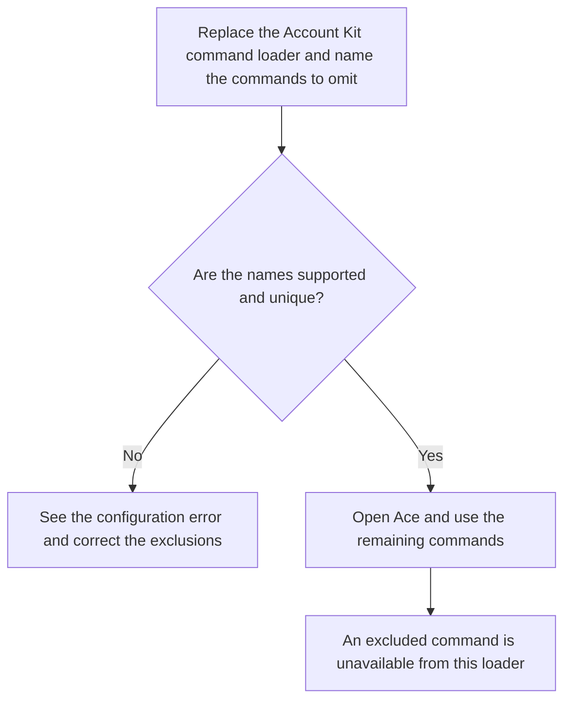
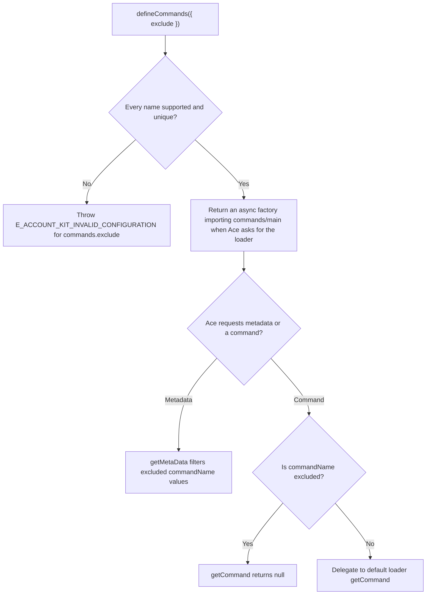

# US-ACCOUNT-66 — Select which Account Kit commands Ace loads

As an application operator, I want to leave out selected Account Kit commands so that Ace exposes only the package commands my application needs.

**Status:** Operator
**Access:** Application configuration access. This controls the main Account Kit command loader in this application.
**Entry:** Replace the package's `./commands` loader in the `commands` array of `adonisrc.ts` with `defineCommands({ exclude })` from `@kevinjohn/adonisjs-account-kit/define_commands`.
**Documentation:** [Leaving out a command](../docs/guide/operations.md#leaving-out-a-command)
**Source:** [defineCommands](../src/define_commands.ts), [default command loader](../commands/main.ts)
**Coverage:** [Command selection tests](../tests/define_commands.spec.ts)

## Acceptance criteria

- The optional `exclude` list contains unique [main-loader command names](PATHS.md#ace-commands). Omit it or use an empty list to retain all main commands. An unknown or repeated name throws `E_ACCOUNT_KIT_INVALID_CONFIGURATION` for `commands.exclude` when `defineCommands` is called.
- Ace does not list or resolve excluded commands through this loader. Existing unrelated command entries stay in `adonisrc.ts`. The four admission runtime commands are in this loader and can be excluded like any other; service APIs have their own entry points. After [rerunning configure](US-ACCOUNT-60-install-account-kit-package.md#acceptance-criteria), check that the default loader has not been added alongside the filtered loader.

## User flow

## Code flow

**Code references:** [defineCommands](../src/define_commands.ts), [default command loader](../commands/main.ts)
