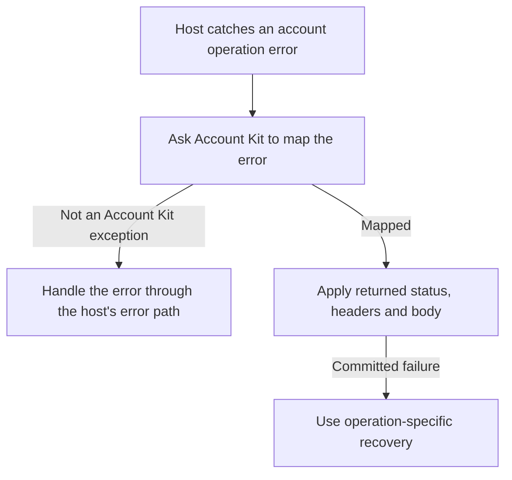
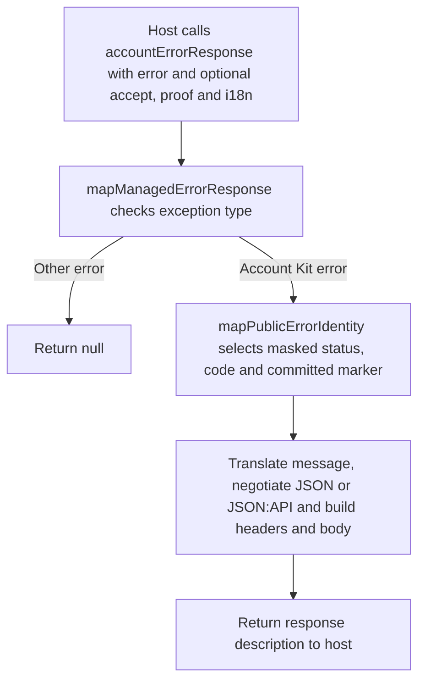

# US-ACCOUNT-67 — Map an account error to a public response

As an application developer, I want to map Account Kit exceptions to safe HTTP responses so that my own routes can report errors consistently with managed routes.

**Status:** Current
**Access:** Host application code handles the exception and decides how to send the returned response.
**Entry:** Call `accountErrorResponse(error, options?)` from the root package export.
**Documentation:** [Error responses](../docs/reference/errors.md)
**Source:** [`accountErrorResponse`](../src/error_response.ts)
**Coverage:** [Error response tests](../tests/http_errors.spec.ts)

## Acceptance criteria

- The required `error` may be any value. Non-Account Kit exceptions return `null`; the host must handle them separately. Options are `accept?`, `proof?` (`password`, `email`, `invitation` or `magicLink`) and `i18n?`. Omitted options select JSON and generic invalid-token mapping.
- The result contains `status`, `contentType`, `headers` and an `errors` body. JSON entries use `message` and can include a field; JSON:API entries use `title`. The host applies the status, content type and headers, appending `Vary` to any existing value. Responses include `Cache-Control: no-store`; throttled errors also include `Retry-After`.
- [Public identity mapping](REFERENCE.md#managed-request-and-response-boundary) masks internal details. A post-commit failure carries `committed: true`; a delivery failure also follows a commit but does not carry that marker. Recovery depends on the operation and committed mutations must not be replayed.

## User flow

## Code flow

Scope: the public mapper returns a response description; the host owns logging and sending it.

**Code references:** [public mapper](../src/error_response.ts), [public identities and headers](../src/error_identity.ts), [exception definitions](../src/errors.ts), [root export](../index.ts)
